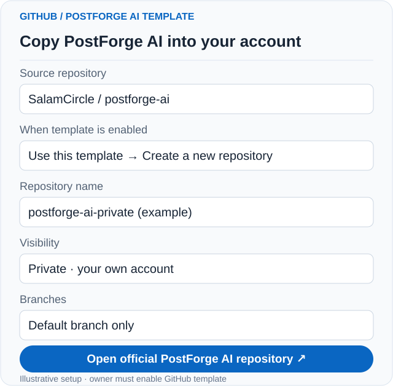
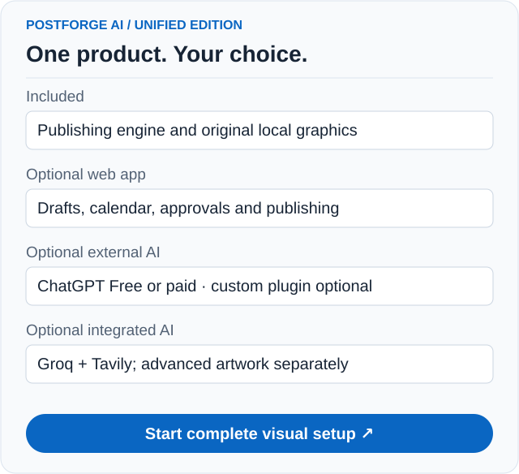
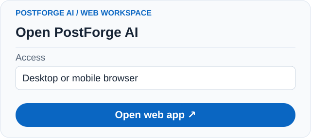
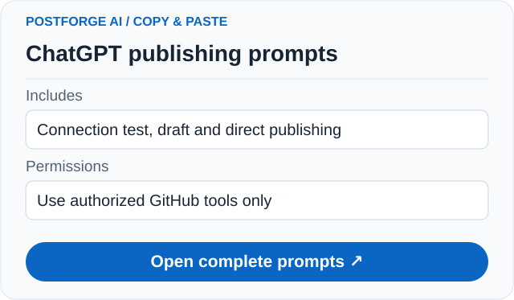

# PostForge AI — V2 Pro Unified Edition

**Research. Create. Publish.**

MIT-licensed, provider-independent LinkedIn publishing and content workspace. One private installation with optional AI integrations and a separate static dashboard. Existing users do not need to reinstall.

## Start here

The clean Unified Edition distribution must pass release checks before template activation. Once **Use this template** is available on the official repository, choose your own account, select **Private**, and copy only the default branch. Never fork or expose a live private workspace.

## Open the dashboard

The hosted dashboard is already available; self-hosting is optional. The [frontend-only website branch](https://github.com/SalamCircle/postforge-ai/tree/website-template) has a root-ready static client. A separate website template repository is required for one-click self-hosting.

## Connect ChatGPT

Use ordinary ChatGPT with authorized repository access. No OpenAI API key is required by the publishing engine. Write access and availability vary; read-only users can import drafts. Optional Groq, Tavily and Workers AI require their own supported configuration and quotas.

## Security and activation

Keep the publishing repository private. Use your own LinkedIn developer application, scoped GitHub tokens and Actions secrets. Keep live publishing, timed publishing and integrated AI disabled until you verify the exact account, configuration and intended content. Never add payment details just to bypass limits.

This distribution excludes private publishing records, credentials and private repository history. See [verification](docs/VERIFY.md), [security](SECURITY.md), [licence](LICENSE) and [privacy](https://salamcircle.github.io/postforge-ai/mobile/privacy.html).

[Legacy V1 source](https://github.com/SalamCircle/postforge-ai/tree/v1-legacy) · [Changelog](CHANGELOG.md)
