# PostForge AI V2 — Alpha


**Research. Create. Publish.**

MIT-licensed, LLM-independent publishing engine. LinkedIn is the first supported platform. External AI tools supply researched content; GitHub Actions validates, renders and publishes it using the member API.

## V2 developer preview

**2.0.0-alpha.1 — not production-ready.** Existing V1 publishing remains available. V2 adds offline history, queue inspection, draft planning and schedule previews. Live engagement and automatic production upgrades are not yet verified.

[Start with V2 — fresh installation](docs/INSTALL-V2.md) · [Upgrade rehearsal](docs/ALPHA-INSTALL.md) · [Stable V1](https://github.com/SalamCircle/postforge-ai/tree/main)

## Choose your experience

[](#start-here--five-steps-to-publish)

[](docs/ALPHA-INSTALL.md)

Keep V1, or choose V2 after its release. Separate authorised accounts can use independent private deployments.

## Discover V2 Core — Content Studio

**Turn your next post into a repeatable content strategy.** Use your preferred AI, keep your brand context and manage drafts, reviews, scheduling dates and publication receipts in one repository.

> **Development preview:** the Content Studio implementation is undergoing private verification. The public alpha does not yet include the new engine. The calendar below is an illustrative design, not a working web dashboard. Existing daily publishing remains available; advanced engagement requires separately approved LinkedIn API access.

[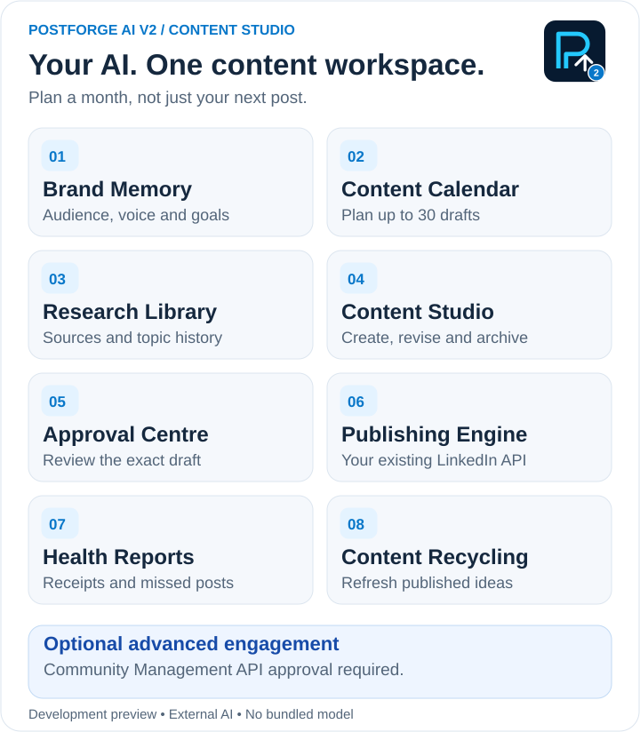](docs/INSTALL-V2.md)

### From idea to publication

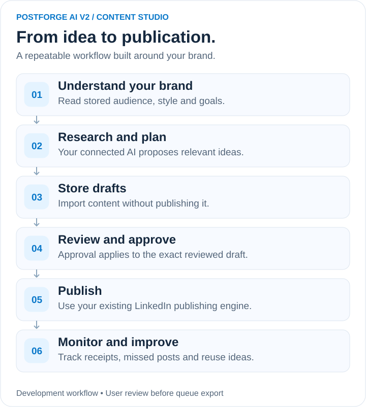

### Your content calendar

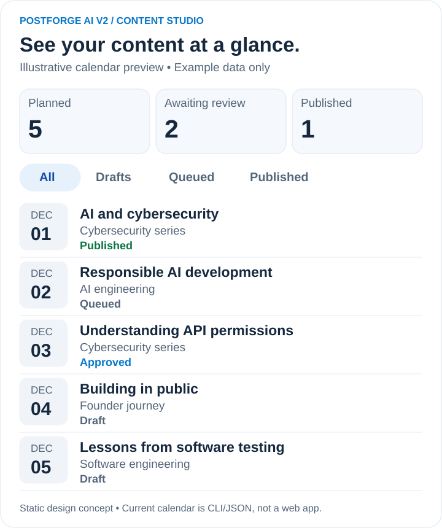

### Start with a conversation

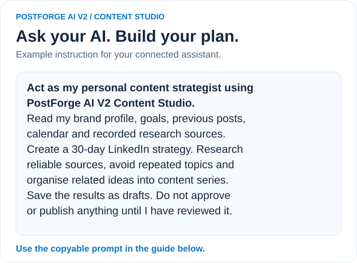

<details>
<summary>Copy the example AI prompt</summary>

```text
Act as my personal content strategist using PostForge AI V2 Content Studio.

Read my stored brand profile, professional goals, previous publications, content calendar and research sources. Create a 30-day LinkedIn content strategy relevant to my audience. Research reliable sources, avoid repeated topics, organise related ideas into content series and prepare original drafts with appropriate visuals.

Save everything as drafts. Do not approve, queue or publish anything until I have reviewed it.
```

</details>

### Explore what Core brings together

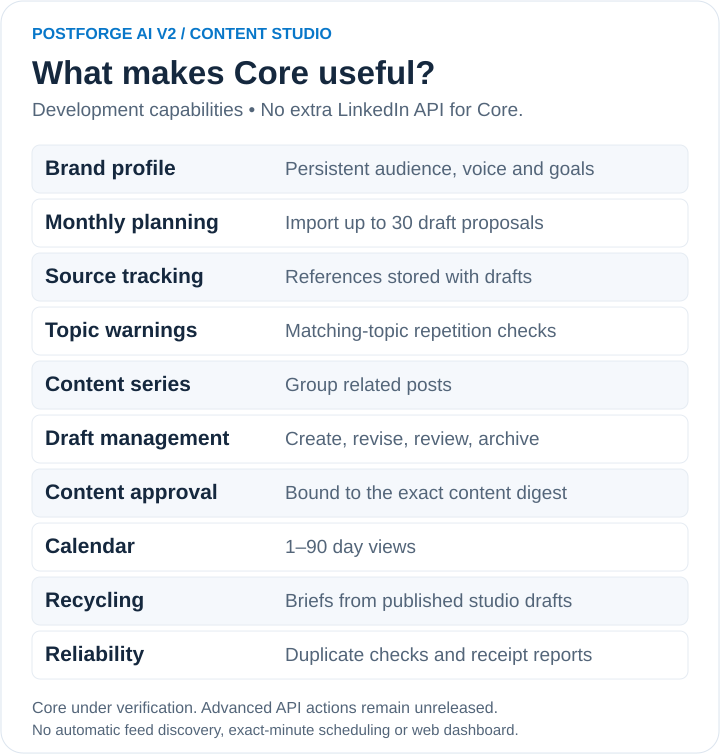

[Explore setup and availability](docs/INSTALL-V2.md)

## Start here — five steps to publish

**From setup to your first post.**

Five simple steps. Your AI. Your timing. Tap each card to continue.

[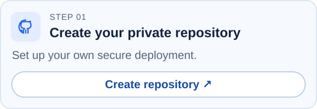](https://github.com/new)

[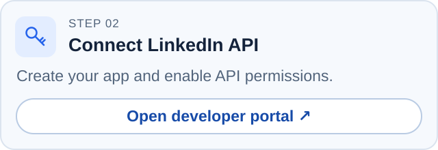](https://www.linkedin.com/developers/apps)

[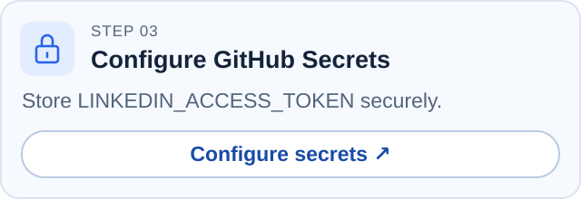](docs/START-HERE.md#step-5--store-your-token-securely)

[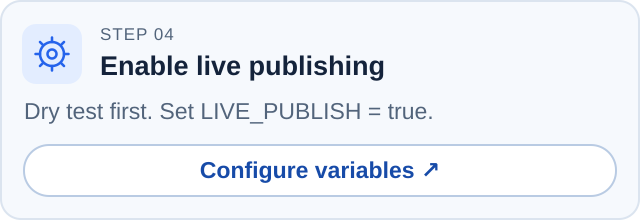](docs/START-HERE.md#step-8--verify-your-live-post)

[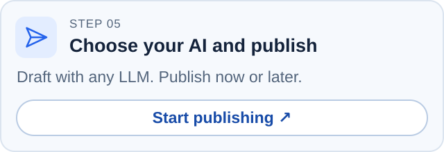](#publish-anytime--your-choice-of-ai)

[Full beginner walkthrough](docs/START-HERE.md) · [OAuth token tools](https://www.linkedin.com/developers/tools/oauth)

**Open your own private repository → Settings → Secrets and variables → Actions.** Use the Secrets tab for the token and the Variables tab for the live switch. Do not configure credentials in the public source repository.

## Publish anytime — your choice of AI

PostForge AI is free MIT-licensed software, not a bundled AI subscription. Draft with any LLM (ChatGPT, Gemini, Claude, a local model) or write manually. Review the content before saving it. No particular LLM API key is required by the publisher.

**On demand:** in your configured private deployment, create a unique `queue/YYYY-MM-DD-topic.json` file using today's UTC date and commit it to main. This triggers publishing automatically. Alternatively, open Actions → PostForge Publisher → Run workflow on main. The workflow processes today's queue, not future dates.

**Scheduled:** queue a future UTC date. The workflow checks daily at 9 AM UK time (with daylight-saving adjustment); GitHub may delay scheduled runs. For other time zones, adjust both the cron and time guard. Multiple unique posts per day are supported; identical content is blocked by persistent receipts.

Example queue content (replace the date with today's UTC date or your intended future date):

```json
{
  "date": "2026-11-24",
  "text": "Your reviewed LinkedIn post goes here."
}
```

Ask your preferred LLM: “Draft a factual LinkedIn post about my chosen topic. Return JSON with date and text, no invented claims, maximum 3000 characters.” Save it to the private queue only after reviewing it. Live publishing requires your own authorized LinkedIn token and explicit LIVE_PUBLISH opt-in. GitHub Actions quotas, LinkedIn API limits and optional AI provider fees apply; check your plan and avoid paid overages. See [Setup](docs/SETUP.md) and [verification](docs/VERIFY.md).

## Documentation
[LLM prompts](docs/PROMPTS.md) · [Security review](docs/AUDIT.md)

## Features
- Dated JSON queue and optional original PNG graphics.
- Explicit live opt-in, dry-run validation and persistent content-based claims and multiple posts per day.
- HTTPS endpoint restrictions and no redirect following.
- Automated unit tests and reusable provider-neutral prompts.

## Architecture

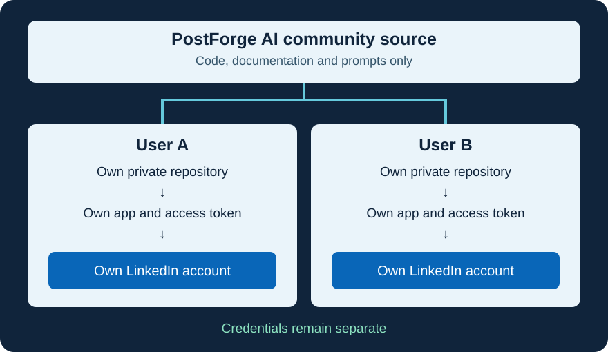
External scheduler → private queue → GitHub Actions → LinkedIn API → publication receipt.

## Community edition status

This is the clean-history source distribution. It has **no deployment token or personal posting receipts**. Each user should create a private deployment with their own LinkedIn developer application and credentials. The included test suite and security audit must pass in each deployment. See [setup](docs/START-HERE.md).

## Licence
[MIT](LICENSE). See [Security](SECURITY.md) for responsible reporting.

## Multiple posts and duplicate protection


[Follow the visual multi-post scheduling and verification guide](docs/MULTI-POST.md). Choose your own publishing frequency, create unique queue files and preserve content-based receipts. The diagram illustrates intended behaviour; live verification is separate.

## Optional advanced engagement — separate setup
Core publishing uses the existing LINKEDIN_ACCESS_TOKEN. No Community Management API is required for Core. Drafts are generated by your chosen external AI, not by a bundled model; the offline planner records supplied text and does not discover posts or generate comments. A user-supplied post is a manual fallback, not automatic discovery.

Advanced live comments, replies and reactions are planned, not released. They require an eligible LinkedIn developer application with approved Community Management API access and the appropriate endpoint permissions. LinkedIn may require a separate application, verified organisation and additional review. See [official eligibility](https://learn.microsoft.com/en-us/linkedin/marketing/community-management-app-review). Do not remove products from your working publishing application. A separate engagement credential is proposed; do not configure it until an adapter is released and verified. No scraping or browser automation fallback. Feed discovery is not promised and requires separate verified read access.
