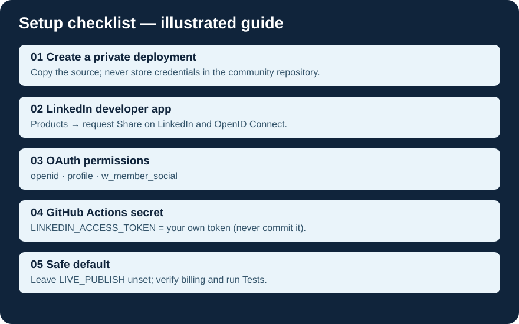
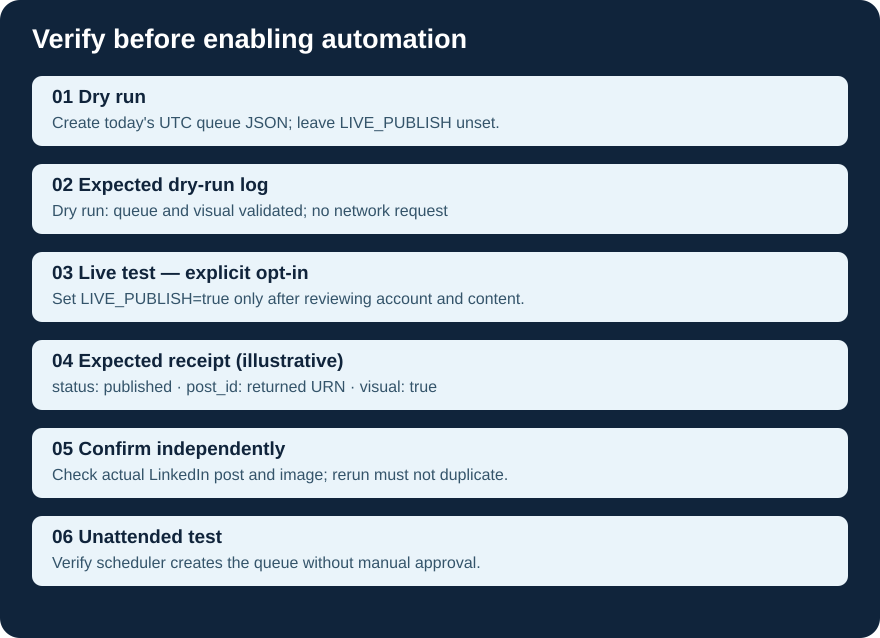
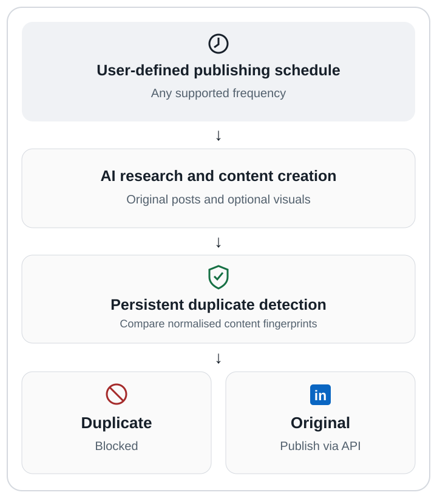

# PostForge AI

**Research. Create. Publish.**

MIT-licensed, LLM-independent publishing engine. LinkedIn is the first supported platform. External AI tools supply researched content; GitHub Actions validates, renders and publishes it using the member API.

## Start here — beginner walkthrough

[Follow the complete step-by-step visual walkthrough](docs/START-HERE.md).

## Quick start
Read [Setup](docs/SETUP.md), [LLM prompts](docs/PROMPTS.md) and [Security review](docs/AUDIT.md). Deploy in your own private repository with your own LinkedIn app and secret. Live publishing is disabled by default. Public copies cannot publish using the supplied workflow.

## Features
- Dated JSON queue and optional original PNG graphics.
- Explicit live opt-in, dry-run validation and persistent content-based claims and multiple posts per day.
- HTTPS endpoint restrictions and no redirect following.
- Automated unit tests and reusable provider-neutral prompts.

## Architecture

External scheduler → private queue → GitHub Actions → LinkedIn API → publication receipt.

## Community edition status

This is the clean-history source distribution. It has **no deployment token or personal posting receipts**. Each user should create a private deployment with their own LinkedIn developer application and credentials. The included test suite and security audit must pass in each deployment. See [setup](docs/START-HERE.md).

## Licence
[MIT](LICENSE). See [Security](SECURITY.md) for responsible reporting.

## Guided setup links

| Step | Open |
|---|---|
| Create private deployment | [Create repository](https://github.com/new) |
| Create developer application | [LinkedIn Developer Portal](https://www.linkedin.com/developers/apps) |
| Request publishing access | [Share on LinkedIn instructions](https://learn.microsoft.com/en-us/linkedin/consumer/integrations/self-serve/share-on-linkedin) |
| Request identity access | [OpenID Connect instructions](https://learn.microsoft.com/en-us/linkedin/consumer/integrations/self-serve/sign-in-with-linkedin-v2) |
| Generate member token | [OAuth tools](https://www.linkedin.com/developers/tools/oauth) |
| Secure token storage | [GitHub Secrets instructions](https://docs.github.com/en/actions/security-for-github-actions/security-guides/using-secrets-in-github-actions) |
| Configure connector | [GitHub installations](https://github.com/settings/installations) |
| Check tests | [Community CI](https://github.com/SalamCircle/postforge-ai/actions) |
| Inspect publication | [LinkedIn feed](https://www.linkedin.com/feed/) |

Follow the [full guided setup](docs/SETUP.md) before enabling live mode.

## Visual onboarding

[Illustrated setup guide](docs/SETUP.md) · [Verification walkthrough](docs/VERIFY.md)

## Multiple posts and duplicate protection

[Follow the visual multi-post scheduling and verification guide](docs/MULTI-POST.md). Choose your own publishing frequency, create unique queue files and preserve content-based receipts. The diagram illustrates intended behaviour; live verification is separate.
