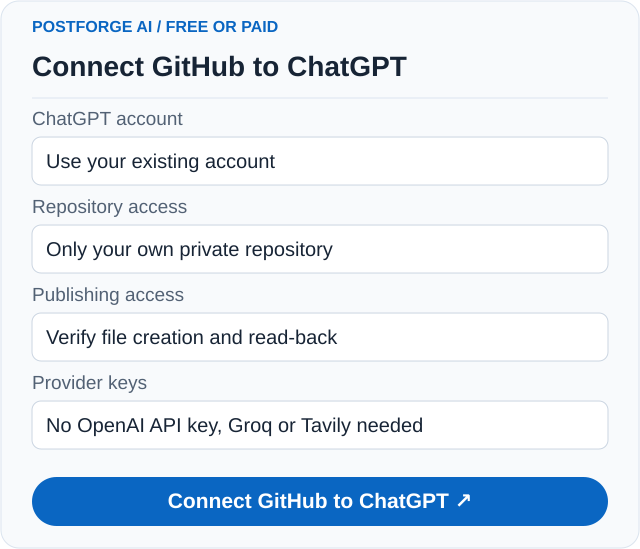
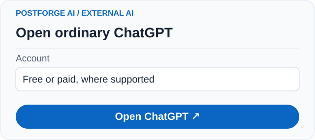
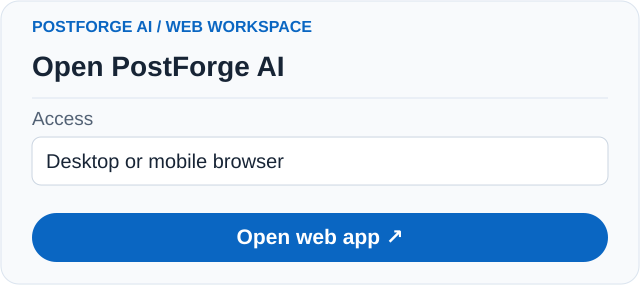

# Connect ordinary ChatGPT (Free or paid)

No custom PostForge plugin or OpenAI developer payment method is required for the ordinary ChatGPT route. One Free account demonstrated read/write access and a successful LinkedIn publication on 25 November 2026. This is evidence for that account, not a guarantee for every Free user. A standard GitHub connection may be read-only. Account eligibility, authorization, platform confirmations and usage limits apply. No paid APIs are required for this route; verify included GitHub Actions capacity.

## 1. Connect GitHub

[](https://chatgpt.com/plugins/github)

[](https://chatgpt.com/)

Authorize only your own private PostForge repository. Never paste tokens in chat. Official connection help: https://help.openai.com/en/articles/11145903-connecting-github-to-chatgpt.

## 2. Check ChatGPT capabilities (read-only)

Copy the capability prompt in the web app, or substitute your own repository in the template below.

```text
Act as my PostForge AI connection checker. Repository: [PRIVATE OWNER/REPO]. Branch: main. Use actual connected GitHub tools, not guesses. Verify that this repository is private, main is the default branch, and read access works. Read .github/workflows/publish.yml and scripts/publish.py. Identify whether create_file and fetch_file are actually available and whether push permission is reported. Inspect today's queue and matching state receipts; report any other due unpublished posts or unresolved claims that could block a safe direct publishing test. Do not read or request secret values. Report read access, reported push permission, file-creation tool availability, current queue safety and limitations separately. Tool availability is not proof of a successful write. Do not create files, modify settings, dispatch workflows or publish.
```

## 3. Verify your connection

Open your connected PostForge web workspace → Calendar → Connect ChatGPT (or More → Integrations). Generate the verification prompt, copy it into ordinary ChatGPT, then refresh in the app. The generated nonce is unique to your repository and device. A matching record proves a write at that time, not identity or continuous permission. If using the manual template below, replace placeholders; use the app-generated challenge if you want the UI to verify it. A record push may trigger offline tests; no publisher is intentionally dispatched.

```text
Verify my PostForge AI connection to my own private GitHub repository [PRIVATE OWNER/REPO] (main). Inspect actual GitHub read and create_file tools. Verify private visibility and default branch main. I explicitly authorize creating ONLY the new connection record studio/connections/chatgpt-[CHALLENGE].json with version 1, challenge [CHALLENGE], repository [PRIVATE OWNER/REPO], and created_at in current UTC ISO 8601. Check whether this exact file exists first; never overwrite or blindly retry an uncertain operation. Use the actual create-only tool and read back the exact record. Report commit SHA and file URL. Do not create drafts, queue posts, change settings or publish anything. Ordinary regression tests may run; stop if paid usage is required.
```

### Interrupted write — recovery prompt

Use the original app-generated challenge. Never generate another record merely because a tool response was interrupted.

```text
Continue the authorized PostForge AI GitHub write test. Repository: [PRIVATE OWNER/REPO]. Branch: main. The previous execution may have ended without confirmation. First inspect the exact path studio/connections/chatgpt-[CHALLENGE].json on current main with fetch_file. If the record exists, verify its version, challenge, repository and created_at and report its URL; do not write again. Only if the exact file is confirmed absent, create that same file with version 1, challenge [CHALLENGE], repository [PRIVATE OWNER/REPO], and current UTC ISO 8601 created_at. I explicitly authorize that single non-publishing create-only operation. Read back the exact file and report the commit SHA if returned and file URL. Do not generate another challenge, overwrite anything, or retry an uncertain write. Do not create queue files, publish to LinkedIn, dispatch publishing workflows or change repository settings. Ordinary tests may run; stop if paid usage would be required.
```

## 4. Draft mode — recommended

Choose Prepare draft only and copy the prompt. Import the returned JSON into PostForge, review and publish only when ready.

```text
Act as my PostForge AI content assistant for [PRIVATE OWNER/REPO]. Research one current AI or cybersecurity topic (or my requested topic) using reliable primary sources. Create a professional LinkedIn post with verified source URLs and an optional original graphic brief without PostForge branding or promotional signatures. Return ONLY an import-ready JSON array with one object containing id (unique lowercase letters/digits/hyphens, max 48 characters), date (YYYY-MM-DD UTC), title (max 120), topic (max 100), text (max 3000), sources (up to 12 verified HTTPS URLs), and optional visual {title (max 70), points (2–4 strings, max 80 each), layout: "impact", labels (2–6 short names or phrases grounded in the post, max 80 each)}. Use actual values, not placeholders. Do not create files, queue, publish, request credentials or use paid APIs. I will import and review the draft in PostForge AI.
```

## 5. Direct publishing — explicit opt-in

Use this only for your own configured publisher. Choose Publish one post directly, check the consent box, copy the prompt and paste into ChatGPT. Replace the repository placeholder when using this README template. Copying itself does not publish. The prompt adapts the successful Free-account test, with an additional renderer/no-brand guard and explicit quota and account checks. The existing queue-push route may process all due entries, so stop if any other unconfirmed due post or unresolved claim exists. GitHub tools may be unavailable; use import mode then. Never retry uncertain publication.

```text
Act as my PostForge AI LinkedIn publishing assistant.

I own and authorize access to the following private GitHub repository:
Repository: [PRIVATE OWNER/REPO]
Branch: main

My LinkedIn publishing engine must already be configured with a valid LinkedIn access token and LIVE_PUBLISH enabled. Verify the setup without requesting or exposing secrets. Check included GitHub Actions minutes and stop if paid usage would be required.

Your task is to research, create and directly publish one new LinkedIn post using your connected GitHub tools.

Step 1 — Verify capabilities
Check whether your GitHub connection supports reading and creating files. Verify that the repository is private and main is the default branch. Read .github/workflows/publish.yml and scripts/publish.py. If only read access exists, stop and explain; offer an import-ready draft instead.

Step 2 — Research and create
Research one current, factual AI or cybersecurity development using reliable primary sources (or a topic I explicitly specify). Write a professional original LinkedIn post with verified source links, maximum 3000 characters. Create an original graphic specification containing a title (maximum 70 characters), 2–4 short points (maximum 80 characters each), layout: "impact", and 2–6 optional labels naming only tools or ideas supported by the post. Do not add PostForge AI branding, watermarks or promotional signatures. Check the actual renderer; if it would add unwanted branding, stop and offer text-only or reviewed alternatives.

Step 3 — Safety checks
Inspect the complete current UTC day's queue and publication receipts in state/. Compute the exact fingerprint using the current publisher's algorithm and ensure no duplicate exists. Ensure there are no unresolved claims, conflicting files or other due unpublished posts that could be unintentionally published. Refresh main immediately before writing. Stop if these checks cannot be completed reliably, or if live configuration or intended LinkedIn account cannot be confirmed. Never change settings to enable live mode.

Step 4 — Publish through GitHub
Create exactly one new JSON file in the queue directory on main. Use the current UTC date and a unique filename in the format queue/YYYY-MM-DD-chatgpt-free-test-unique.json. Follow the actual repository schema:
{
  "date": "CURRENT_UTC_DATE",
  "text": "Original LinkedIn post with verified source links.",
  "visual": {
    "title": "Relevant graphic title",
    "points": ["First key insight", "Second key insight", "Third key insight"]
  }
}
Replace all placeholders with actual researched content. If the renderer supports impact layout, add `layout: "impact"` and 2–6 grounded labels to the visual object. Use the authorized create-only GitHub action, never overwrite. The existing PostForge Publisher workflow automatically runs when a queue JSON file is pushed.

This request explicitly authorizes one real LinkedIn publication to my configured account. No additional editorial approval is required from me. Respect any mandatory platform confirmation.

Step 5 — Verify delivery
Check the PostForge Publisher workflow and matching state/ receipt. Report the GitHub commit, workflow run and LinkedIn post URL. Only claim successful publication if the receipt confirms it. Do not retry an uncertain write or publication; inspect the existing record first.

Do not change application code, workflows, repository settings, credentials or existing files. Do not request API keys, payment details or paid services. Execute using actual connected tools, not sample code.
```

## 6. Verify the result

Refresh the PostForge workspace and inspect Published posts and the corresponding receipt. The workflow is .github/workflows/publish.yml in your own private repository. A successful workflow run alone is not proof of LinkedIn publication. A matching published receipt with post ID is required. The backend renders the graphic specification; verify actual image appearance separately. Built-in AI remains available separately for configured Groq/Tavily accounts.

```text
Verify the result of my most recent PostForge AI publishing request in [PRIVATE OWNER/REPO] on main. Use the exact queue filename, fingerprint or LinkedIn post ID from this chat or ask me for it if unknown. Inspect the matching queue JSON, state receipt and publisher workflow evidence if available. Report whether the status is published, queued, claimed/uncertain or not found. Only report publication when the matching receipt has status published and a valid post ID. Provide the receipt URL, workflow URL if verified and LinkedIn post URL. Check whether the archived graphic exists when the receipt references one. Do not retry, create files, dispatch workflows, edit receipts or publish anything.
```

[](UNIFIED-SETUP.md)

[](https://salamcircle.github.io/postforge-ai/mobile/)

The enhanced connection centre requires the approved frontend deployment.
