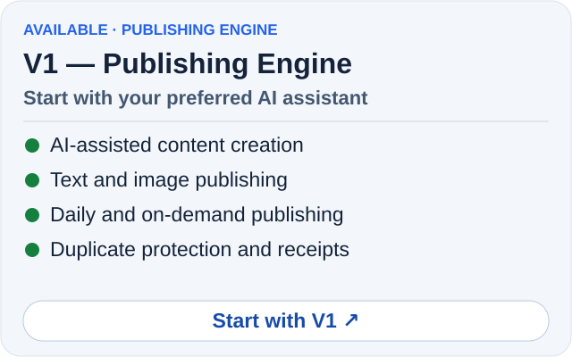
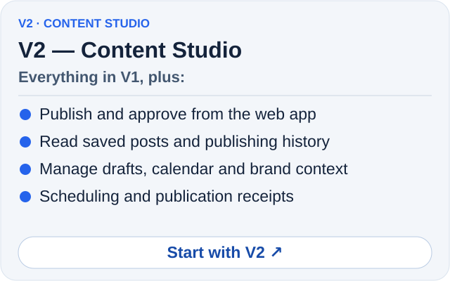
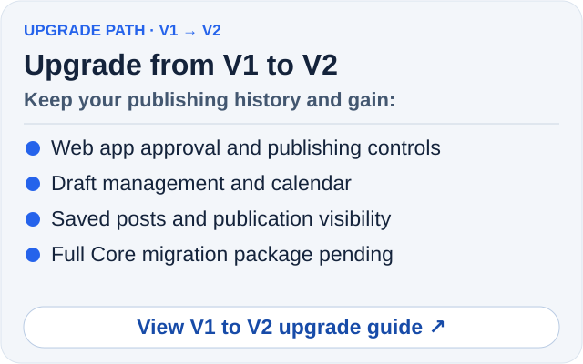
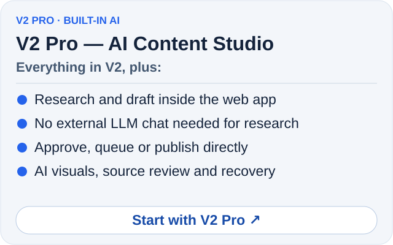
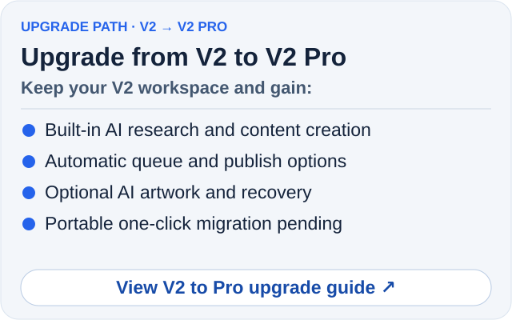
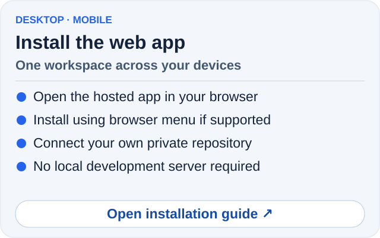
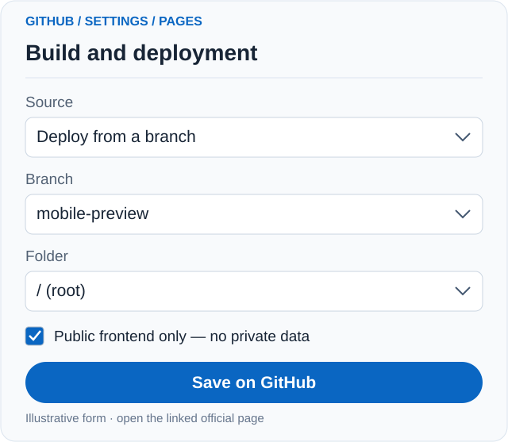
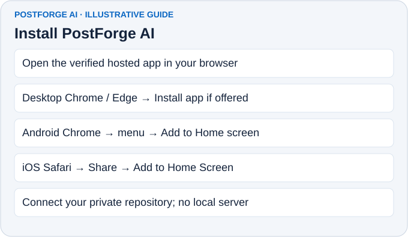

# Choose your PostForge AI edition

Choose your edition or upgrade path. Each card links to the relevant guide. The full Core and Pro migration packages still require release acceptance.

## Start with V1

[Begin complete setup](VISUAL-SETUP.md). Keep your existing V1 installation if you only need external AI and publishing.

## Start with V2

[**Start with V2 — open setup guide →**](https://github.com/SalamCircle/postforge-ai/blob/v2-pro-portable/docs/CONTENT-STUDIO.md)

Use a reviewed complete Core distribution in a fresh private repository. The public source must contain the compatible installation marker, scripts and workflows. The old Alpha package alone is not Core. [Core guide](CONTENT-STUDIO.md) · [Web app](https://salamcircle.github.io/postforge-ai/mobile/). Do not copy a personal private deployment or its data.

## Upgrade V1 to V2

The historical Alpha upgrade workflow installs the historical Alpha package only, from a pinned commit on the private development branch. It is not a full Core or Pro migration and is not portable to arbitrary new repositories. Do not run it on installed V2/Pro. For a V1 migration, back up the same-account deployment, pause all writers and disable live publishing, reconcile unresolved claims, test on a private rehearsal copy, and use a reviewed full Core migration package when available. Preserve queue, state and credentials; never run both live publishers for the same account. [Versioning safeguards](VERSIONING.md).

## Start with V2 Pro

[**Start with V2 Pro — open complete setup guide →**](https://github.com/SalamCircle/postforge-ai/blob/v2-pro-portable/docs/V2-PRO.md)

Use a reviewed full Pro distribution with Core installed. [Pro setup and provider keys](V2-PRO.md). The hosted frontend by itself does not install a backend.

## Upgrade V2 to V2 Pro

Use the [portable migration candidate](PORTABLE-INSTALL.md), which requires explicit review of the plan. Do not use the Alpha workflow as a substitute. Use a reviewed Pro package on a backed-up private rehearsal workspace; preserve Core data, verify the installation marker and all Pro workflows, test before enabling providers. Existing Pro users do not need to reinstall. [Pro acceptance workflow](https://github.com/SalamCircle/postforge-ai/blob/v2-pro-portable/.github/workflows/pro-release-acceptance.yml) is a test, not an installer. It consumes provider quotas and Actions minutes; confirm free-only configuration first.

## Deploy or install the web app

For maintainers: deploy only the clean public frontend branch mobile-preview from root. For users: open the existing hosted app; no GitHub Pages changes are needed.

[Hosted app](https://salamcircle.github.io/postforge-ai/mobile/) · [Connection and permissions](MOBILE.md) · [Visual setup](VISUAL-SETUP.md)

All illustrations are recreated examples, not authenticated live screenshots. Private example Actions links require access; use equivalent paths in your own repository. Public full Core/Pro distributions and automated migration require separate release acceptance.
