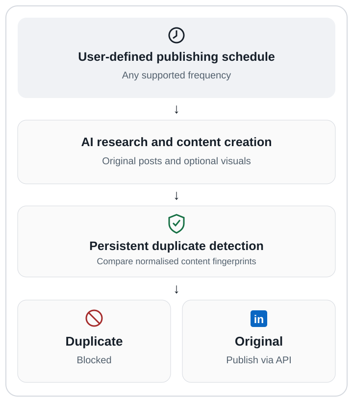

# Multiple posts and duplicate protection



## Step 1 — Choose your schedule

Choose your own times in your external AI scheduler, for example 09:00, 13:00 and 17:00 in your local timezone. No hard-coded daily post limit applies. Check provider quotas, platform rules and billing before increasing frequency.

## Step 2 — Create separate queue files

Each scheduled execution should research a different useful topic and create a unique file using the UTC date and a unique suffix, for example:

| Queue file | Content | Expected outcome |
|---|---|---|
| queue/2026-11-23-090000.json | Cybersecurity basics | Publish |
| queue/2026-11-23-130000.json | AI learning resources | Publish |
| queue/2026-11-23-170000.json | Cybersecurity basics (identical text) | Block |

Use today's actual UTC date in the filename and JSON date field. Never overwrite an existing queue file. The publisher processes current UTC day entries in filename order when invoked; the filename does not itself schedule a future publication.

```json
{"date":"2026-11-23","text":"Example original post text","visual":{"title":"Security basics","points":["Check links","Use MFA"]}}
```

The visual field is optional. Use 2–4 short points when a graphic adds value.

## Step 3 — Understand duplicate protection

The publisher normalises case, Unicode and punctuation and computes a SHA-256 fingerprint. A persistent receipt in state/<fingerprint>.json blocks repeated content across filenames and dates. A claim is recorded before the public post request; uncertain claims require manual investigation, not automatic retries. Keep state history intact. Older receipts without fingerprints and posts published outside this system are not fully covered. Reworded posts may evade exact-content matching.

## Step 4 — Verify safely

Leave LIVE_PUBLISH unset for dry runs. In your private deployment, open Actions and inspect Tests and PostForge Publisher. The dry run validates content and renders visuals without contacting LinkedIn; it does not prove live duplicate prevention. The regression test uses mocked API calls to check two distinct posts and a duplicate, including reruns. For a live test, review the content, account and billing, enable LIVE_PUBLISH and confirm actual posts and receipts. Verify the duplicate produces no additional public post. Stop on uncertain results.

[](https://github.com/SalamCircle/postforge-ai/actions)

[Full verification guide](VERIFY.md) · [Reusable scheduler prompts](PROMPTS.md) · [Beginner setup](START-HERE.md)

The diagram describes intended implementation, not proof of successful live testing.
