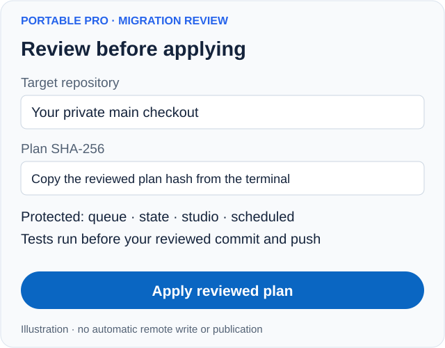

# Portable V2 Pro release candidate

Includes the V1 publishing engine, V2 browser workspace and V2 Pro research backend. No private user data or secrets are shipped. This branch is a release candidate, not a stable release. Review the Actions test results before using it. No local server is required; Git and Python are needed for the reviewed migration command only.

## Fresh installation

1. Open the [portable source branch](https://github.com/SalamCircle/postforge-ai/tree/v2-pro-portable). Download its ZIP or clone that branch. Review the source and test results.
2. Create an empty **private** GitHub repository. Import the clean source into its main branch (GitHub's Import repository or Git push with your own GitHub authentication). Do not import the private maintainer deployment or its history. Do not set LIVE_PUBLISH, TIMED_PUBLISH or PRO_AI_ENABLED yet.
3. Follow [V1 foundation](VISUAL-SETUP.md), [V2 browser connection](CONTENT-STUDIO.md) and [Pro provider setup](V2-PRO.md). Check billing, keep paid overages disabled and test in review mode before enabling anything.

## Migrate V1, Alpha or V2 to Pro

The installer automates the source-file update locally, not a public API or background action. It refuses a dirty checkout, invalid identity, unsupported version, symlinks and changed plans. It preserves README, queue, state, scheduled, studio, repository secrets and variables. Existing customised managed files are listed with old/new hashes and are replaced only after explicit plan review. No automatic push or commit is performed.



1. Stop external writers, disable LIVE_PUBLISH, TIMED_PUBLISH and PRO_AI_ENABLED in the target repository, and reconcile uncertain claims. Back up the same-account private deployment. Never run two live publishers for the same account.
2. Clone the reviewed portable branch and your own private deployment main into separate sibling folders. Use your normal GitHub authentication; do not share a token. Verify the release commit in the source checkout.
3. In PowerShell (or terminal), from the parent folder, install the release's Python dependencies using a trusted Python environment.

```powershell
python -m pip install -r postforge-source/requirements.txt
python postforge-source/scripts/portable_install.py plan my-private-repo
```

4. Read every listed path and review changes in your own checkout/source. Copy the exact printed plan_sha256. The following command rechecks the plan, installs files and runs the Python suite offline with publishing disabled. On test failure, replaced files are restored.

```powershell
python postforge-source/scripts/portable_install.py apply my-private-repo --expect YOUR_REVIEWED_PLAN_SHA256
```

5. Review git status/diff. Verify protected history and the intended repository. Commit the reviewed code changes, then push using an authenticated Git client with permission to modify workflows. GitHub may require workflow-specific permissions. Do not force push; if main advanced, stop and reconcile. Do not include personal files.
6. Run your repository's Tests and Verify V2 Content Studio workflows. Follow [Pro acceptance](V2-PRO.md) before enabling live publishing. Use the existing hosted web app; no local development server is necessary.

No automatic remote migration is claimed: a GitHub Actions default token may not have permission to change workflow files. The explicit owner push is required. Do not grant broad persistent credentials to an automated installer. 
