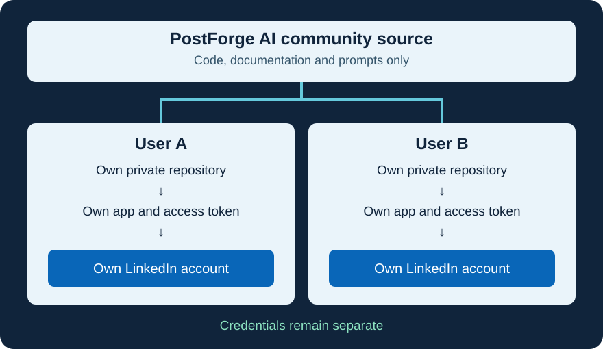
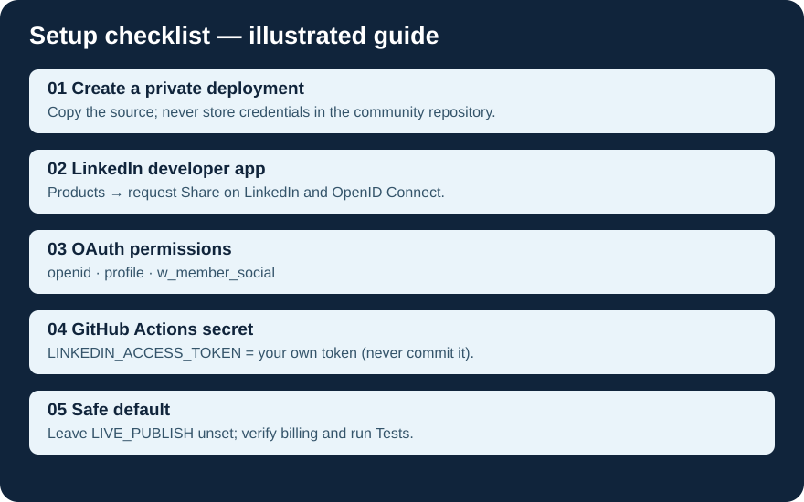
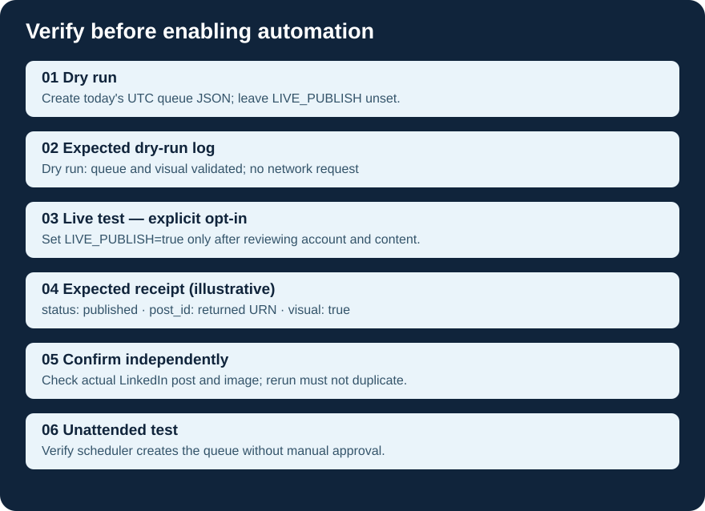
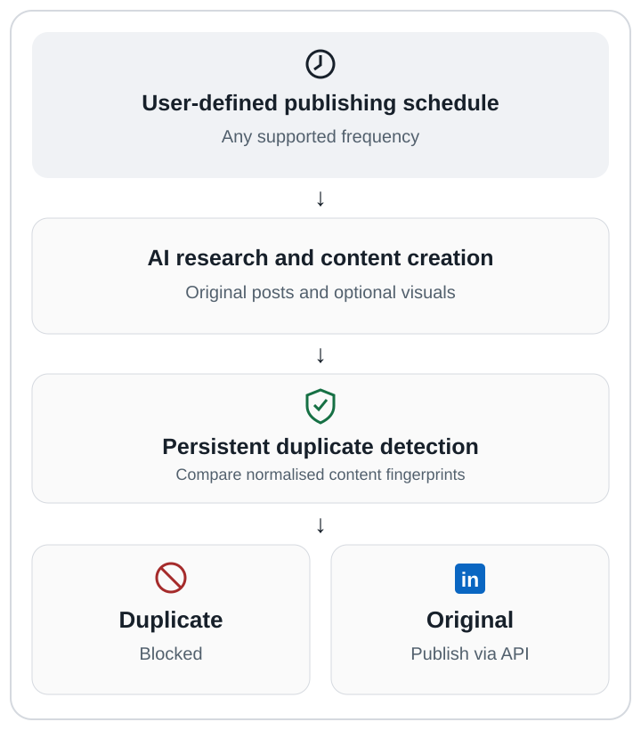

# PostForge AI — guided setup

## 1. Create your private deployment
[Create a GitHub repository](https://github.com/new) · [GitHub template instructions](https://docs.github.com/en/repositories/creating-and-managing-repositories/creating-a-repository-from-a-template)

Copy the project into a private repository. Do not add credentials to the public community repository.

## 2. Create your LinkedIn application
[Open LinkedIn Developer Portal](https://www.linkedin.com/developers/apps)

Select Create app, choose your own app name, upload a square logo, select an eligible LinkedIn Page, provide a privacy policy if required and review the API terms. If offered, the Default Company Page for Individual Developer may be appropriate; availability varies. Do not select a data-portability-only page for publishing.

## 3. Request both products
[Open My Apps](https://www.linkedin.com/developers/apps) → select your app → Products.

| Product | Action | Scopes |
|---|---|---|
| [Share on LinkedIn](https://learn.microsoft.com/en-us/linkedin/consumer/integrations/self-serve/share-on-linkedin) | Request access | w_member_social |
| [Sign In with LinkedIn using OpenID Connect](https://learn.microsoft.com/en-us/linkedin/consumer/integrations/self-serve/sign-in-with-linkedin-v2) | Request access | openid, profile |

Wait until both products are enabled. Email scope is unnecessary. Check Auth for granted scopes.

## 4. Generate your own token
[Open OAuth token tools](https://www.linkedin.com/developers/tools/oauth). Select your app and authorise your own member account with openid, profile and w_member_social. Note expiry. Never screenshot or share the token.

## 5. Store the token securely
In YOUR private repository: Settings → Secrets and variables → Actions → New repository secret.
[Official GitHub secrets guide](https://docs.github.com/en/actions/security-for-github-actions/security-guides/using-secrets-in-github-actions)

Name: LINKEDIN_ACCESS_TOKEN
Value: your own access token, pasted directly into GitHub.

Leave LIVE_PUBLISH unset. Check [GitHub billing](https://github.com/settings/billing) and enforce zero overage before running Actions.

## 6. Connect an LLM
[ChatGPT](https://chatgpt.com/) · [GitHub installed applications](https://github.com/settings/installations)

Connect GitHub if your LLM supports it. Restrict repository access to your deployment. Use [the prompts](PROMPTS.md). Schedule your preferred publishing times in your timezone; confirm unattended write permissions separately. Other LLMs need equivalent scheduling and write tools.

## 7. Safe test
In your deployment open Actions → Tests. Review results. Copy examples/post.json into queue/YYYY-MM-DD-HHMMSS.json using today's UTC date. Leave LIVE_PUBLISH unset. Check publisher logs for dry-run validation; this does not authenticate with LinkedIn.

## 8. Live test
Only after reviewing the account, billing and content, set repository variable LIVE_PUBLISH to true and manually dispatch PostForge Publisher on main. Inspect state/<content-fingerprint>.json and [LinkedIn activity](https://www.linkedin.com/feed/). Verify image appearance. Never retry an ambiguous claim. Unset LIVE_PUBLISH to stop future publishing. Revoke exposed tokens immediately.

## 9. Troubleshooting
401: check expiry and secret. 403: check product access and scopes. Missing run: check Actions settings and queue path. Claimed receipt: inspect LinkedIn before retrying. No automatic research occurs without an external scheduler. No guarantee of zero provider charges.

The links to repository-specific settings must be opened in your own private deployment, not the community source repository.

## Visual verification

Follow the [detailed verification walkthrough](VERIFY.md).

## Multiple posts and duplicate protection

[Follow the visual multi-post scheduling and verification guide](MULTI-POST.md). Choose your own publishing frequency, create unique queue files and preserve content-based receipts. The diagram illustrates intended behaviour; live verification is separate.
