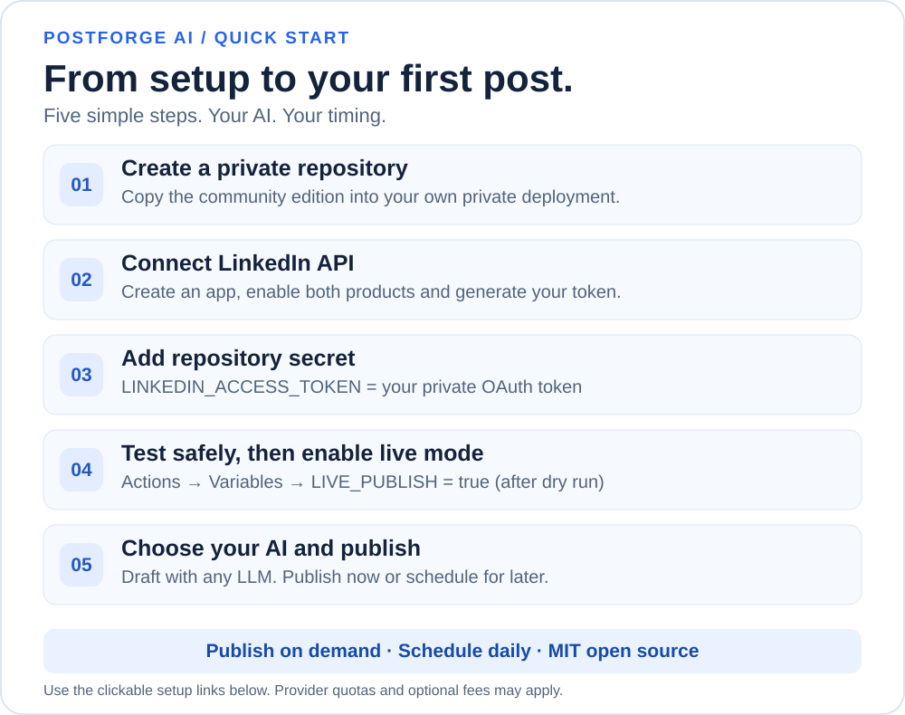
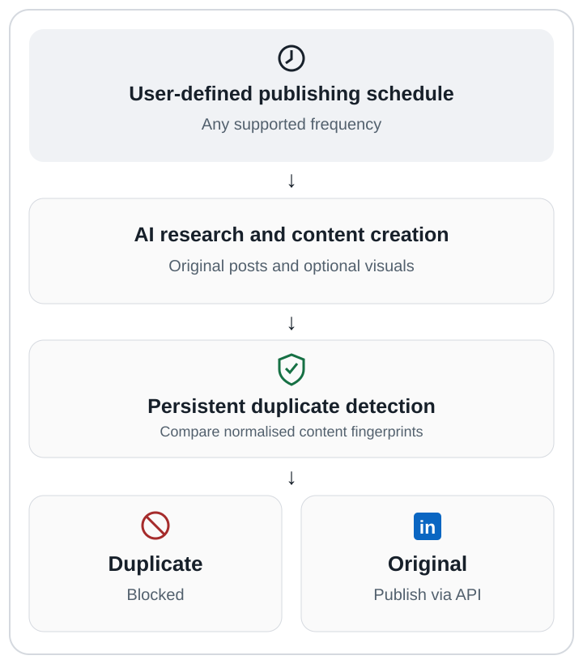

# PostForge AI — start here

No coding experience required. Follow each step in order. All buttons open the relevant website; you must complete the actions yourself. Keep your deployment private and never share credentials with an AI assistant.



## Step 1 — Create your own private deployment

Copy the project files into your private repository. Do not create a public deployment containing credentials.

[](https://github.com/new)

---

## Step 2 — Create a LinkedIn developer application

Select Create app, enter your own app name, choose an eligible LinkedIn Page, upload a logo and review the terms.

[](https://www.linkedin.com/developers/apps)

---

## Step 3 — Request both products

Select your app, open Products, request Share on LinkedIn and Sign In with LinkedIn using OpenID Connect. Wait for access.

[](https://www.linkedin.com/developers/apps)

**Check:** Both products are enabled. [Publishing access instructions](https://learn.microsoft.com/en-us/linkedin/consumer/integrations/self-serve/share-on-linkedin) · [Identity access instructions](https://learn.microsoft.com/en-us/linkedin/consumer/integrations/self-serve/sign-in-with-linkedin-v2).

---

## Step 4 — Generate your access token

Select your app and authorise your own account with openid, profile and w_member_social. Keep the token private.

[](https://www.linkedin.com/developers/tools/oauth)

---

## Step 5 — Store your token securely

In your private repository select Settings → Secrets and variables → Actions → New repository secret. Name it LINKEDIN_ACCESS_TOKEN and paste your token as the value.

[](https://docs.github.com/en/actions/security-for-github-actions/security-guides/using-secrets-in-github-actions)

**Name:** `LINKEDIN_ACCESS_TOKEN`

**Value:** Your own token (never commit it). Leave `LIVE_PUBLISH` unset.

---

## Step 6 — Connect your AI assistant

Grant your chosen assistant access only to your deployment. Check that scheduled writes work without interactive approval.

[](https://github.com/settings/installations)

---

## Step 7 — Run safe tests

Check billing first. In your own repository open Actions → Tests. Leave LIVE_PUBLISH unset. Copy examples/post.json into queue/YYYY-MM-DD-HHMMSS.json using today's UTC date.

[](https://github.com/SalamCircle/postforge-ai/actions)

**Expected publisher output:**

```text
Dry run: queue and visual validated; no network request
```

This is not an authentication or live upload test. Community test results do not replace your deployment's tests.

---

## Step 8 — Verify your live post

Only after safe testing, confirm your account and content. In your private repository open **Settings → Secrets and variables → Actions → Variables → New repository variable**.

| Field | Enter |
|---|---|
| Name | `LIVE_PUBLISH` |
| Value | `true` |

Click Add variable. [Official variables guide](https://docs.github.com/en/actions/learn-github-actions/variables). This is a repository variable, not a secret or an environment-specific variable. Then open Actions → PostForge Publisher → Run workflow on main. Inspect the receipt and actual image.

[](https://www.linkedin.com/feed/)

**Expected receipt (example only):** `status: published`, `post_id: returned URN`, `visual: true` for an image post. Never retry an ambiguous claim. Unset LIVE_PUBLISH to stop publishing.

---

## Step 9 — Publish on demand or schedule

Commit a reviewed JSON queue file dated today (UTC) to main to trigger publishing, or manually run the workflow. For scheduled publishing, use a future UTC date; the default workflow checks at 9 AM UK time. GitHub may delay execution. Choose any LLM or write manually. No mandatory LLM subscription is required.

## Step 10 — Verify unattended automation

Use [the reusable prompts](PROMPTS.md) to schedule daily research and a queue write. Verify the scheduler, workflow, receipt and actual post independently. See [verification guide](VERIFY.md) and [full setup](SETUP.md). No guarantee of zero provider charges; check billing before running workflows.

## Multiple posts and duplicate protection



[Follow the visual multi-post scheduling and verification guide](MULTI-POST.md). Choose your own publishing frequency, create unique queue files and preserve content-based receipts. The diagram illustrates intended behaviour; live verification is separate.
