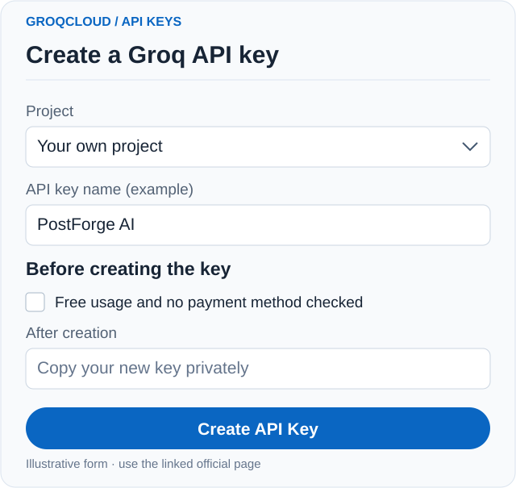
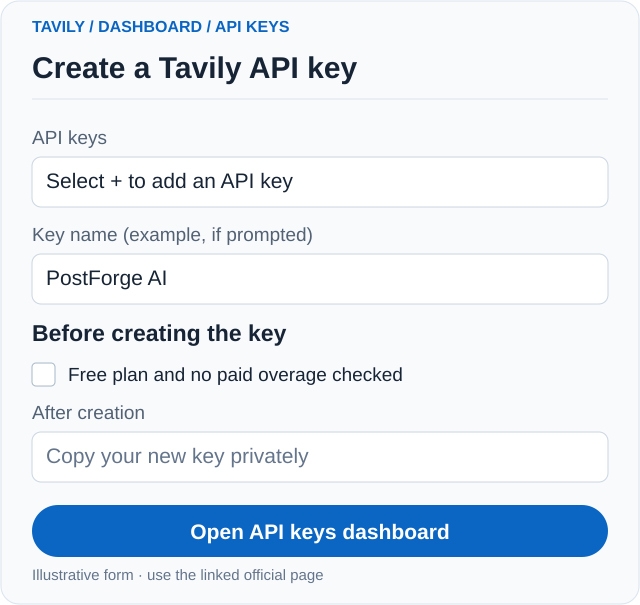
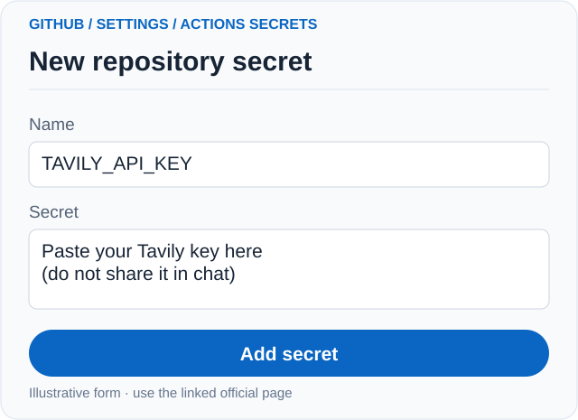
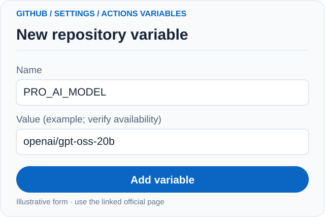
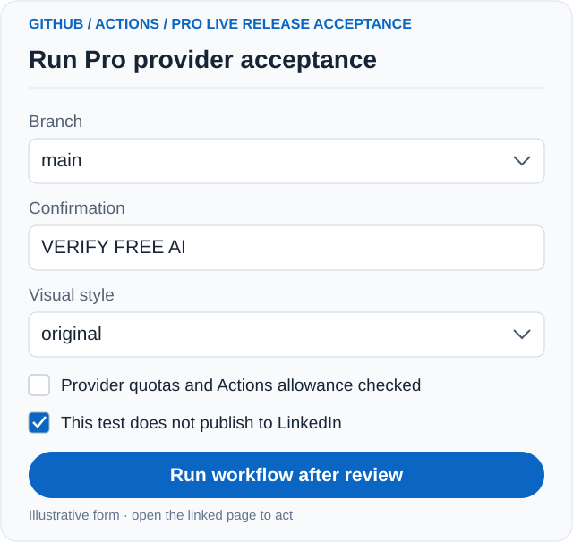
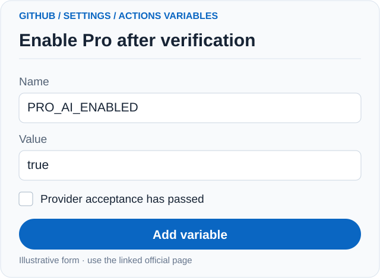
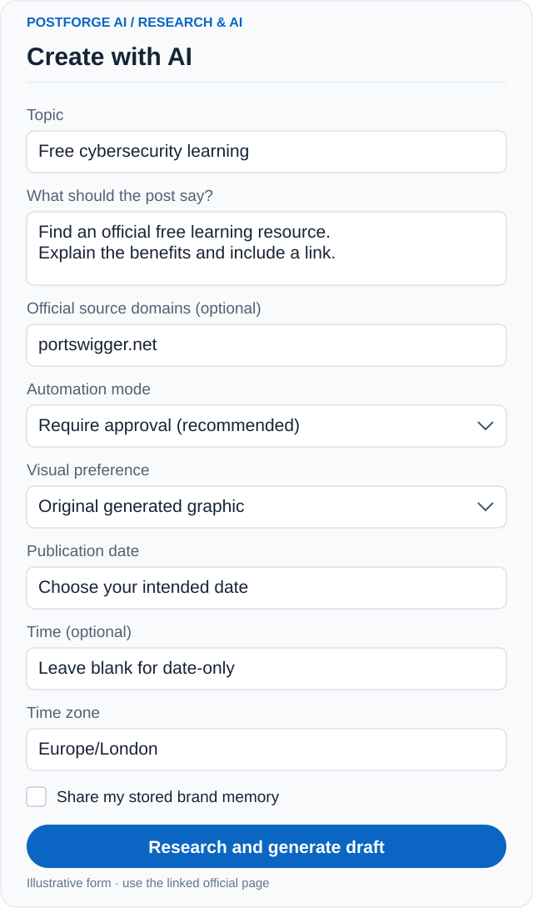
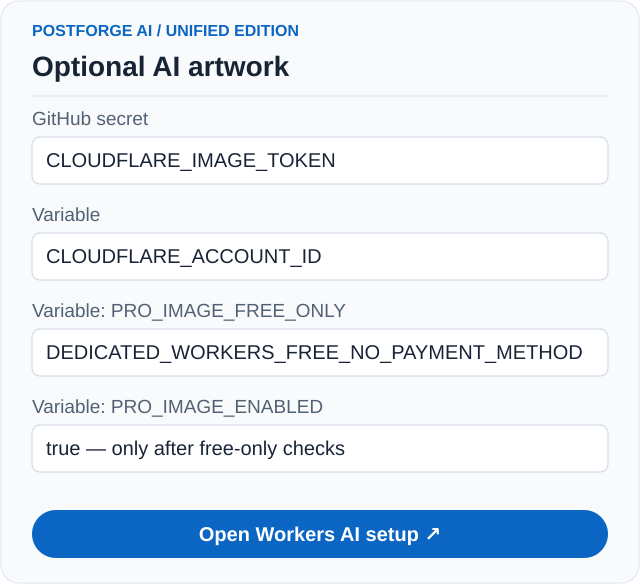
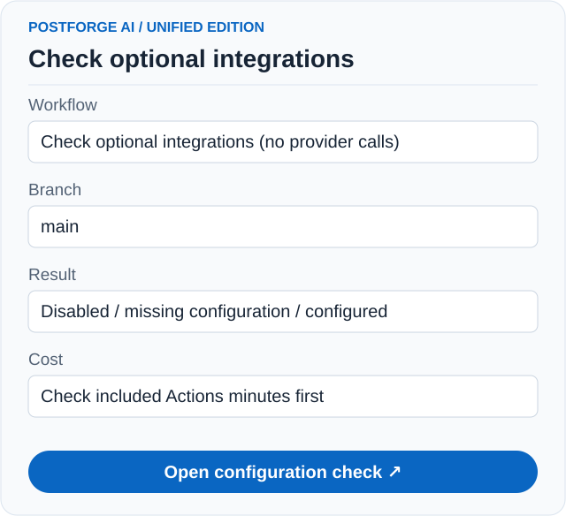
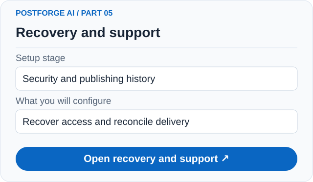

# Part 4 — Optional AI and automation

## Step 10 — Optional: integrated AI research and generation

Skip this entire section if you prefer external AI or manual drafts. Current integrated research requires both Groq and Tavily.

Use a verified eligible free account without payment or paid usage, create a key named PostForge AI and copy privately.

Check free allowance and no paid overages. Create or select your own key and copy privately.

Set PRO_AI_MODEL to an exact supported [Groq model](https://console.groq.com/docs/models) available to your free account. Keep PRO_AI_ENABLED disabled until the provider test passes.

After verifying free quotas, run the acceptance workflow on main, confirmation VERIFY FREE AI, style original. It uses provider and Actions quota, but does not publish. Inspect the result; do not enable billing or blindly retry.

Set PRO_AI_ENABLED=true only after verification. The same Unified Edition app works without these keys; the backend rejects unconfigured AI requests before provider calls.

Start with Require approval. Review factual claims, links and visual before approving. Choose external AI or manual drafts anytime.

## Step 11 — Optional: advanced AI artwork

Use only a dedicated Workers Free account with no payment method or paid resources; check [current pricing](https://developers.cloudflare.com/workers-ai/platform/pricing/). Create an account-scoped Workers AI token with minimal permissions and copy the account ID. In your private GitHub repository add secret CLOUDFLARE_IMAGE_TOKEN, variables CLOUDFLARE_ACCOUNT_ID and PRO_IMAGE_FREE_ONLY=DEDICATED_WORKERS_FREE_NO_PAYMENT_METHOD. Enable PRO_IMAGE_ENABLED=true only after verifying the free-only conditions. This artwork option is part of the integrated research workflow and therefore also needs Groq and Tavily. Local graphics remain available without these keys. Review the exact generated image, and never enable billing to resolve failure.

## Step 12 — Optional: automation and configuration check

This manual check reports missing, disabled or configured integrations without printing secret values or contacting providers. It does not prove key validity or billing status. Verify quotas first. For timed publishing set TIMED_PUBLISH=true only if desired and free capacity is confirmed. For live publishing set LIVE_PUBLISH=true only after review. Integrated AI can require approval, queue automatically or publish immediately when explicitly enabled and confirmed. Automatic publishing has separate consent; timing is best effort. Do not enable it just to test. [Detailed verification](VERIFY.md).

## Impact graphics (no image API)

Original and Smart fallback graphics now use a topic-specific central illustration, connected cards, luminous accents and readable labels derived from the draft. No external artwork or logo is fetched. The draft editor offers Editorial and Impact layouts; optional labels contain two to six names or short phrases already supported by the post. The preview is illustrative; the final deterministic 1200 × 1200 PNG is rendered by the publishing engine. Existing graphics without a layout retain the original editorial renderer. Optional AI artwork remains separate and disabled unless configured.
