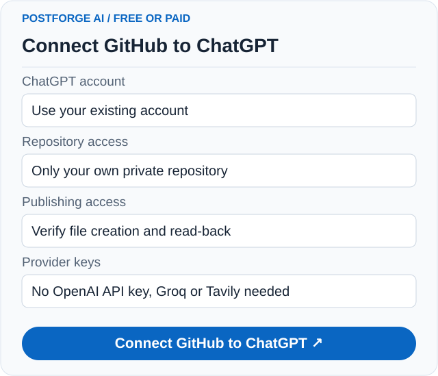
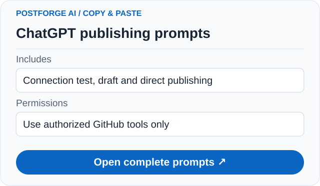
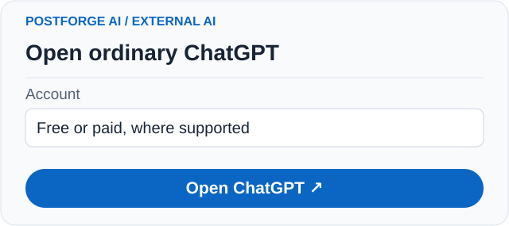
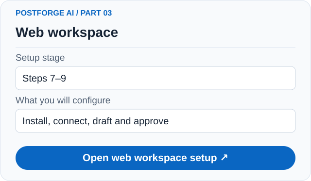

# Part 2 — Connect ordinary ChatGPT

## Step 6 — Optional: connect ordinary ChatGPT (Free or paid)

No custom plugin, OpenAI developer payment method or OpenAI API key is needed for ordinary ChatGPT. Authorize only your own private repository. One Free account demonstrated direct publication; other accounts may only have read access. In the updated app open Calendar → Connect ChatGPT, copy the read-only capability prompt, generate a non-publishing challenge and refresh to verify. A recovery prompt preserves the same challenge if a write is interrupted. Copy the receipt-check prompt after publishing. Use draft-only mode by default, or explicitly authorize one live post with the full queue safety checks. Read-only users import the draft JSON. The enhanced connection centre is under private frontend review. GitHub Actions and ChatGPT limits apply.

