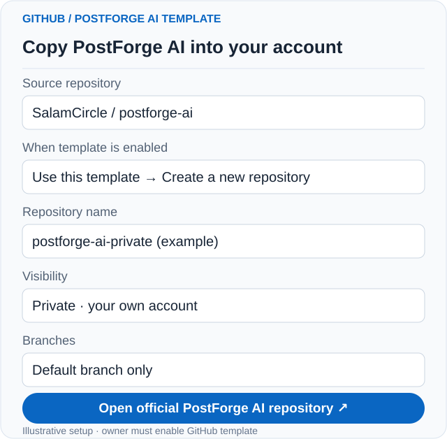
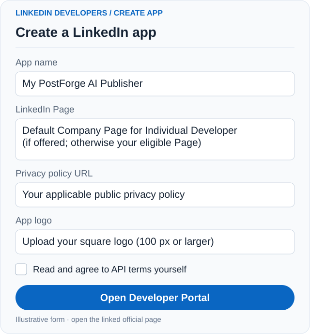
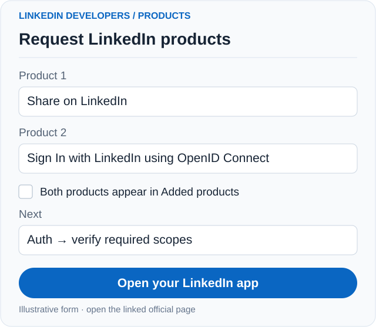
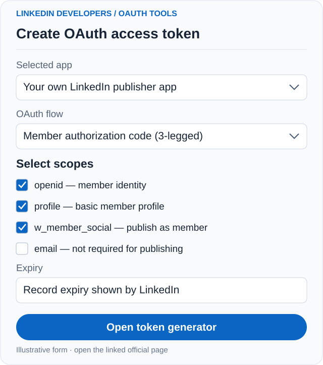
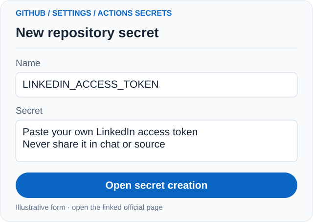
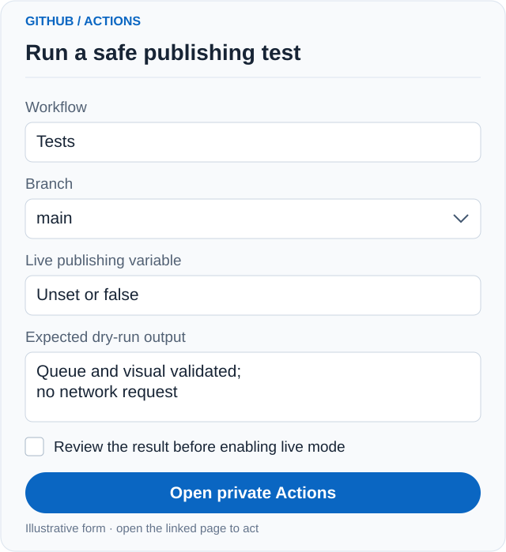
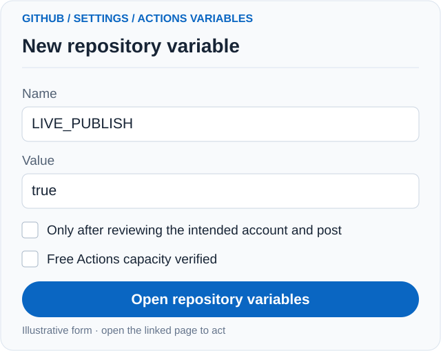
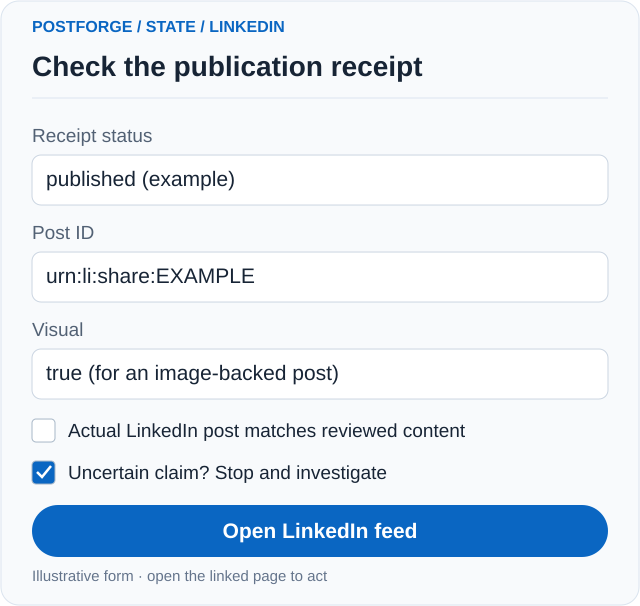
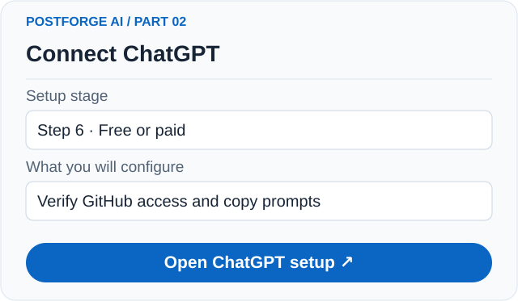
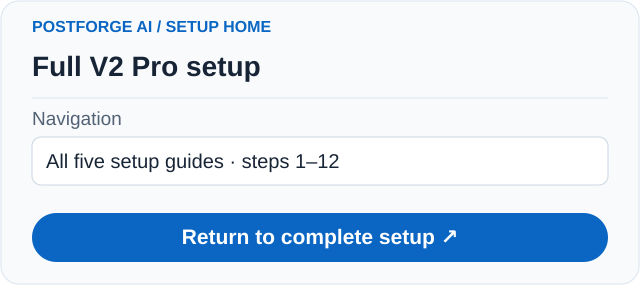

# Part 1 — Publishing foundation

## Step 1 — Copy PostForge AI into your own private repository

**Existing installation?** Keep your own private repository and skip this step.

For a new installation, open the official PostForge AI repository using the visual card. Once GitHub displays **Use this template**, select **Create a new repository**, choose your own account, enter a name such as `postforge-ai-private`, select **Private**, leave **Include all branches** unchecked, and create your copy. The template copies the prepared source; do not create an empty repository, fork a live deployment or upload ZIP files as part of the normal setup.

**Availability:** the Unified Edition default branch passed offline release checks. If **Use this template** is not visible, the repository owner has not activated GitHub's template setting. [Open the template form when enabled](https://github.com/SalamCircle/postforge-ai/generate). Never substitute another person's private deployment.

## Step 2 — Create your LinkedIn developer application

Choose My Apps → Create app. App name example: My PostForge AI Publisher. Select Default Company Page for Individual Developer if offered, otherwise an eligible Page you manage. Provide your applicable public privacy policy, a square logo (at least 100 pixels) and review the API terms. Do not use an unrelated company.

## Step 3 — Request LinkedIn products and member access

Request Share on LinkedIn and Sign In with LinkedIn using OpenID Connect. Confirm both appear under Added products. Open Auth and verify granted scopes.

Select member authorization code (3-legged), openid, profile and w_member_social. Email is not needed for publishing or error diagnosis. Consent for your intended account, copy the token privately and record its expiry.

## Step 4 — Secure the publishing credential

Your repository → Settings → Secrets and variables → Actions → Secrets → New repository secret. Name: LINKEDIN_ACCESS_TOKEN. Paste the token there only. For your own repository append /settings/secrets/actions/new to its GitHub URL. Never share the secret with an AI assistant or browser form.

## Step 5 — Verify and enable basic publishing

Check [GitHub billing](https://github.com/settings/billing) and included Actions allowance; disable paid overages and do not add payment details. Leave LIVE_PUBLISH, TIMED_PUBLISH and PRO_AI_ENABLED unset or false initially. Follow [verification](VERIFY.md) for dry-run validation. Dry runs do not prove authentication or delivery.

After reviewing the exact intended post and LinkedIn account, set LIVE_PUBLISH=true only for intentional publication. Verify the actual post and receipt; never retry an unresolved claim. Keep it off if you only want to prepare drafts.

