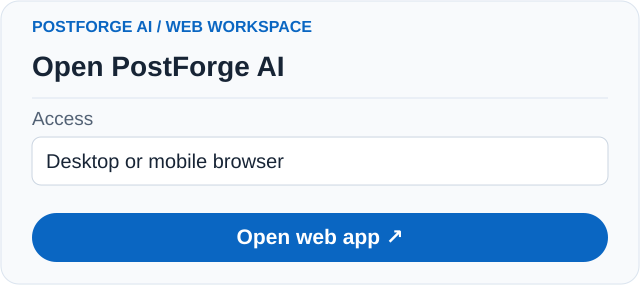
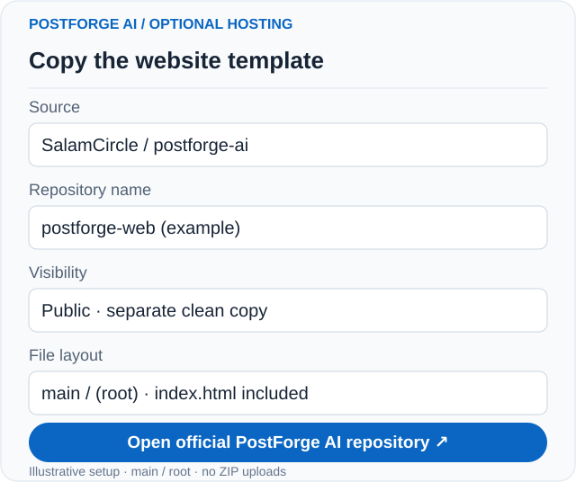
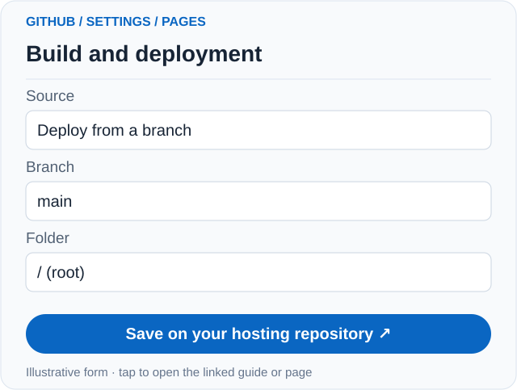
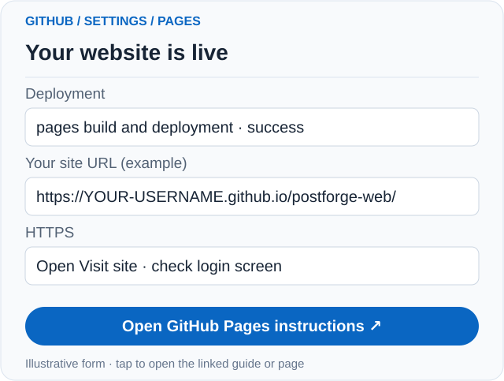
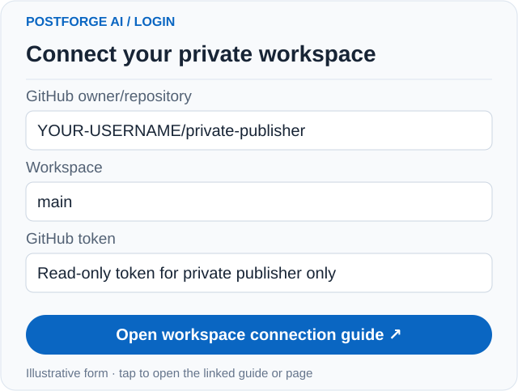
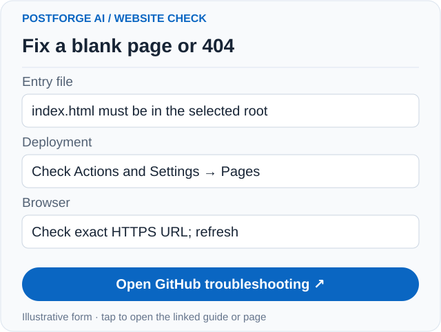
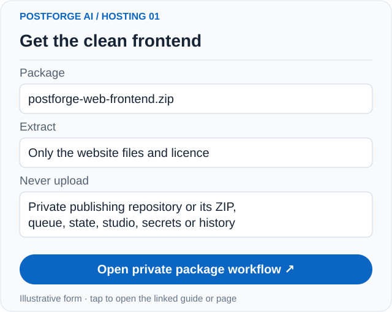
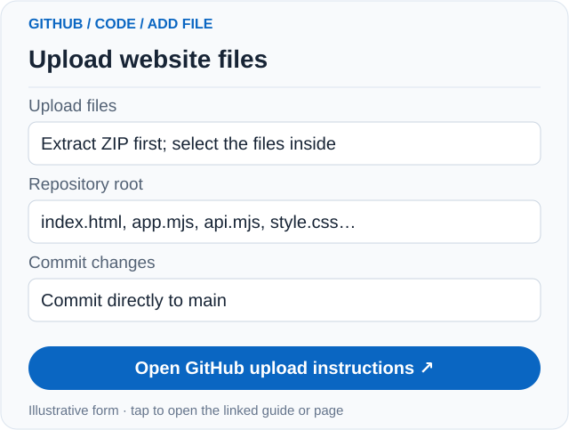

# Step 7 — Publish your own web dashboard (optional)

**Already using the trusted hosted app? Skip hosting entirely.**

If you want your own website, copy the clean official template a second time as a **separate public website repository**, then enable GitHub Pages. No ZIP extraction, manual file upload, custom deployment workflow, local server or paid hosting is needed. Your publishing repository remains private.

## Hosting 1 — Copy PostForge AI for your website (skip if already copied)

Once the owner enables GitHub templates, choose **Use this template → Create a new repository**, your own account, name `postforge-web`, visibility **Public**, default branch only. This is a clean public copy, distinct from your private publishing repository. It contains already-public source and an `index.html` at the root that opens the static dashboard. Never connect the public copy as a publishing workspace or add tokens, records or credentials to it. Publishing workflows require a private repository.

[Open template form when enabled](https://github.com/SalamCircle/postforge-ai/generate). If the template button is absent, use the existing hosted dashboard until the owner activates it. If you already have the prepared public copy, skip to Hosting 2.

For a strictly frontend-only public repository, the [website-template branch](https://github.com/SalamCircle/postforge-ai/tree/website-template) and frontend-only ZIP on [Releases](https://github.com/SalamCircle/postforge-ai/releases) remain available as an advanced alternative.

## Hosting 2 — Enable GitHub Pages

Open your **own public website repository → Settings → Pages**. Under Build and deployment select **Deploy from a branch → main → / (root) → Save**. The root must already contain `index.html` and its relative assets; a prepared template includes them. On Android, use Chrome desktop-site mode if the GitHub app does not expose Pages settings.

## Hosting 3 — Open your dashboard

After the Pages deployment succeeds, open **Settings → Pages → Visit site**. For the example repository the address is `https://YOUR-USERNAME.github.io/postforge-web/`; the root entry opens `docs/mobile/` automatically. Use the exact HTTPS address GitHub displays. Check that the login screen, styles and navigation load before connecting your workspace.

Connect the original **private** publishing repository using a scoped GitHub token. Never enter your LinkedIn token into the browser or add personal records, secrets, scripts or publishing history to the public website repository.

## If your site opens blank or shows 404

Check the branch, root folder, deployment result and exact Visit site address. Confirm that `index.html` and relative assets exist. Do not enter credentials into a broken or untrusted site. Stay within included GitHub quotas; do not enable paid overages.

Advanced maintainer reference — manual frontend packaging (not normal user setup)

### Obtain the clean website files

For maintainers reviewing the private source, use the existing Build Unified Edition source package workflow, main, confirmation BUILD PRIVATE PACKAGE, after checking included Actions minutes and artifact storage. The workflow generates a separate frontend-only ZIP inside the private artifact after verification; this is not an approved public release. Download the **postforge-web-frontend-candidate** artifact, extract its outer archive, then extract postforge-web-frontend.zip. Ordinary users should use the approved frontend-only ZIP when distributed; if the approved complete source ZIP is all you have, extract only the files inside docs/mobile and the LICENSE, not the full archive. Never upload the publishing package itself. Do not use another person's private deployment as source.

### Create a separate public repository

[Open GitHub's new repository form (advanced manual route)](https://github.com/new)

Use your own account. Name the new repository postforge-web (or your own chosen name), select Public, and initialize with a README. This example assumes the branch is main. Your private publishing repository stays private. In GitHub on Android, use Chrome desktop-site mode if the GitHub app does not expose these settings.

### Upload the extracted frontend to the root

In your new hosting repository open Code → Add file → Upload files. Select the extracted files inside the ZIP, not the ZIP or its containing folder, and commit to main. Check that index.html is at the repository root alongside app.mjs, api.mjs, vault.mjs, style.css, sw.js, manifest.webmanifest, the local SVGs, legal HTML pages and LICENSE. The frontend ZIP includes .nojekyll; if the upload picker hides it or you used docs/mobile instead, use Add file → Create new file and create .nojekyll at the root. Do not copy .git, .github, scripts, queue, state, studio, scheduled, credentials or any private workspace files. Review all files before making them public.

