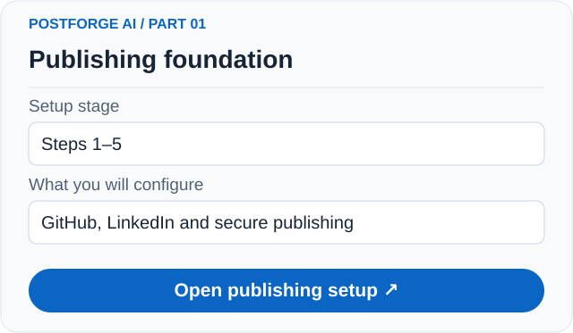
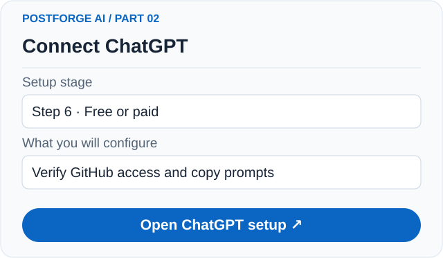
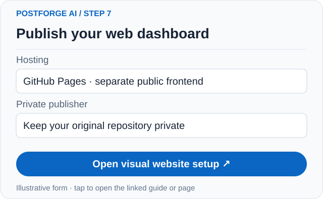
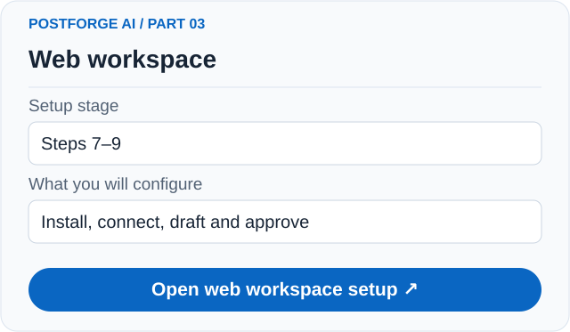
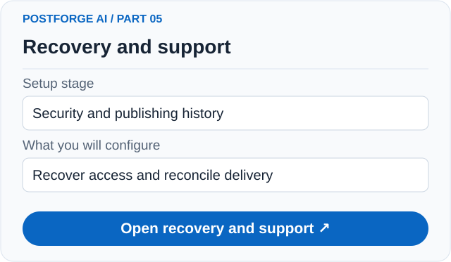

# PostForge AI v2 Pro — Complete visual setup

One installation, optional capabilities. Existing compatible installations do not need to reinstall. New users will copy the approved clean template into their own private repository; the Unified Edition template is not yet released. Existing users can skip installation and use the hosted app. Never copy someone else's private repository.

Tap a visual card to open its guide. The standard hosting route uses a ready-to-deploy frontend template and GitHub Pages main / (root), not manual ZIP uploads. All twelve stages, including optional website hosting, are organised here, with shorter detail pages for reliable mobile loading. Illustrations are examples, not live screenshots.

The enhanced frontend remains under private review; the hosted public client is unchanged.
