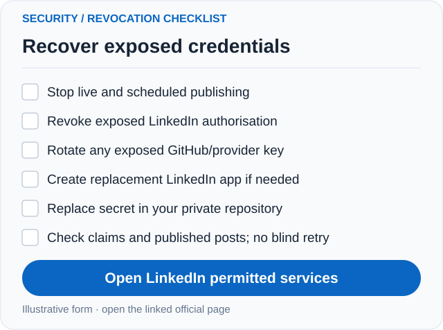

# Part 5 — Recovery and support

## Recover or disconnect

Pause publishing if a credential is exposed. Revoke the affected authorisation, rotate the token, replace the secret and reconcile existing claims; do not remove receipts. If needed create a replacement LinkedIn application using steps 2–4. Revoke GitHub/provider keys with the issuing service. Disconnect ChatGPT in its plugin settings. Use the app's Forget controls only to remove locally saved authorisations.

## Trust and support

[Trust Centre](https://salamcircle.github.io/postforge-ai/mobile/trust.html) · [Terms](https://salamcircle.github.io/postforge-ai/mobile/terms.html) · [Privacy](https://salamcircle.github.io/postforge-ai/mobile/privacy.html) · [Security](../SECURITY.md) · [Troubleshooting and verification](VERIFY.md).

Existing version-specific references are retained only for legacy recovery, not normal onboarding. The private release remains under review; no public synchronisation is authorised.

## Workspace progress and published post library

The Calendar overview shows whether the private workspace is connected and editing is authorized. More → Integrations & features shows setup checkpoints; installed software and historical receipts are not proof that current provider keys or billing are valid. A draft's stage strip describes the current receipt/approval state. Automatic or direct publishing may bypass manual approval or queueing. Uncertain claims and missed delivery require review, not an automatic retry.

Open Calendar → Published posts to search confirmed receipts across the loaded private repository. Select a post to see its text, status, original archived upload (when available) and LinkedIn link. New image-backed publications preserve exact PNG or JPEG upload bytes by SHA-256 in private state/media. Media is deduplicated, bounded to 6 MB per asset, and loaded on demand through authenticated GitHub requests. LinkedIn can resize the uploaded image. Historical posts without archived bytes may show saved source/AI images, text or a link only; never present a recreated graphic as an exact published image. Private media increases repository storage; check included quota and never ship state/media in public packages. Local graphic themes and illustrative composer previews require no image API.

## ChatGPT connection centre

Open Calendar → Connect ChatGPT in the enhanced frontend after deployment. Ordinary ChatGPT is the primary route; a custom plugin is optional. See [the complete ChatGPT connection and publishing prompts](CHATGPT-SETUP.md). A matching one-time connection record verifies a repository write at that time, not ongoing authorization, client identity or LinkedIn access. Forget verification clears the local challenge only; revoke access in GitHub or ChatGPT separately. Creating a connection record may trigger ordinary regression tests, not the queue publisher. ChatGPT-tagged post names help find content but do not authenticate its origin. Published posts lists confirmed receipts for all sources.

