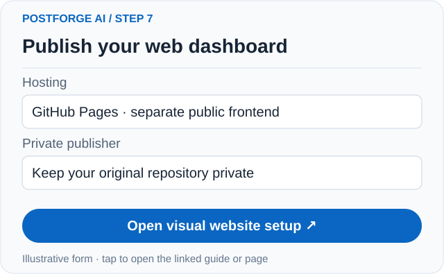
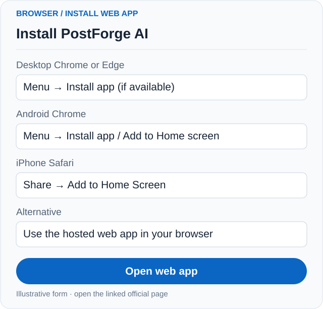
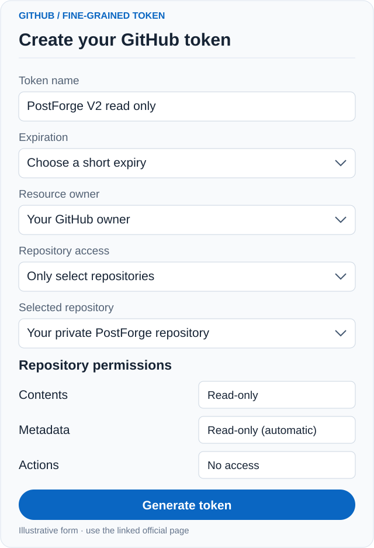
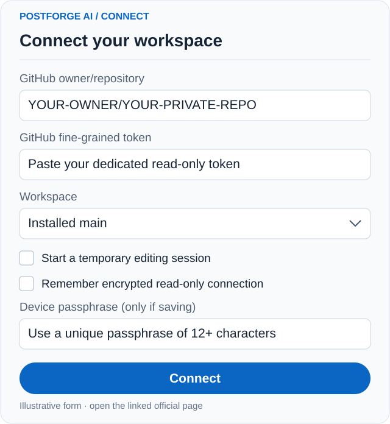
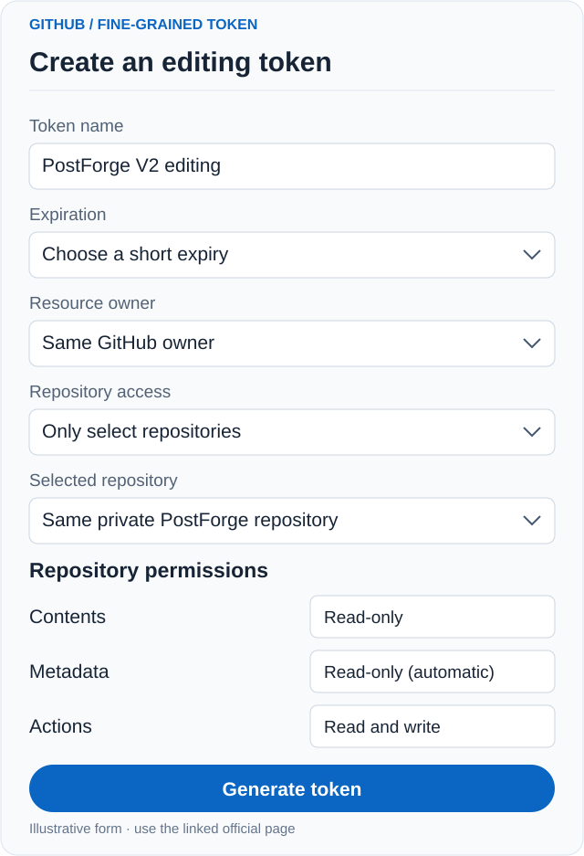
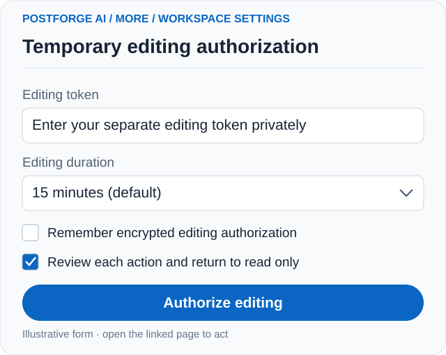
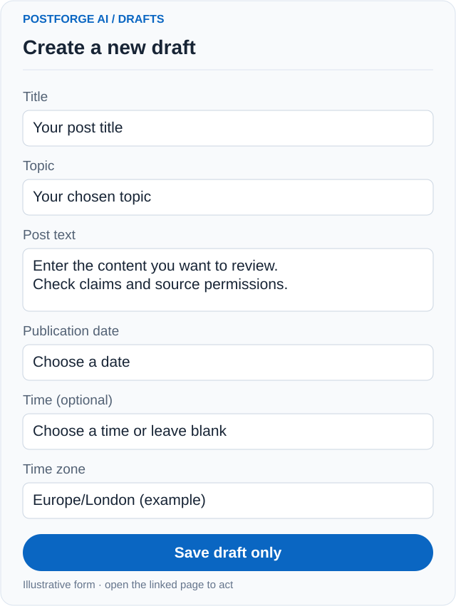
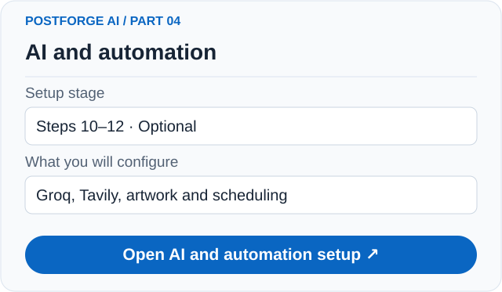

# Part 3 — Web workspace and approvals

## Step 7 — Optional: publish, open or install the web app

If you prefer your own website, complete the visual GitHub Pages guide above before opening your own dashboard. Otherwise use the existing hosted client when available; no personal Pages deployment is necessary.

Use Chrome or Edge on desktop, Chrome on Android or Safari on iOS. Install app / Add to Home Screen if offered; otherwise use the browser. No Python or local server needed. Self-host only the clean frontend as described above; never expose the private publishing repository. For your own site, use its actual Pages URL instead of the shared app links in this guide.

## Step 8 — Connect the workspace

Choose your resource owner, Only select repositories, your private PostForge repository, short expiry, Contents read-only, Metadata read-only (automatic) and no Actions access. Copy privately.

Enter owner/repository and the GitHub token, choose main and Connect. Optional encrypted remember-me requires a unique device passphrase of at least 12 characters. Never paste LinkedIn or AI provider keys into the app.

## Step 9 — Optional: editing, drafts and approvals

Restrict the token to the same repository; Contents read-only and Actions read/write. Actions write may dispatch other workflows in that repository, so use a short expiry.

More → Workspace settings → Enable editing → enter editing token → select duration → Authorize editing. Return to read only when done.

Save draft only. Use Approval to inspect exact content, sources, image and schedule; approve, then queue. Publish now is a separate confirmed action and requires live publication enabled. Verify receipt and real post. ChatGPT users can use Research & AI → Prepare AI brief or Import drafts. The local branded graphic renderer is included without additional image keys.

