# Start with PostForge AI V2 Pro

**Everything in V1 and V2, plus built-in AI research, source-linked content creation, visual generation and direct publishing without needing an external LLM chat.**

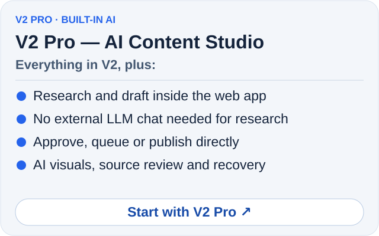

## Step 1 — Choose your starting point

### Starting from scratch

You do not need to install V1, then V2, then Pro as three separate installations. A complete reviewed Pro distribution includes the publishing engine and Core workspace. Set up one private repository with that package, then complete the V1 foundation and the V2 connection steps below. **Use the portable release candidate from the [installation guide](PORTABLE-INSTALL.md); the public V1 main alone is insufficient.** Do not copy someone else's private deployment or try to use the historical Alpha upgrade as a full Pro installer.

[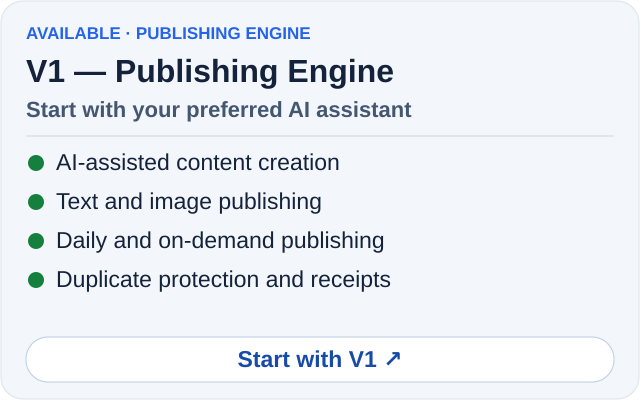](https://github.com/SalamCircle/postforge-ai/blob/v2-pro-portable/docs/VISUAL-SETUP.md)

[**Complete the V1 foundation: LinkedIn app, token, secrets and dry-run tests →**](https://github.com/SalamCircle/postforge-ai/blob/v2-pro-portable/docs/VISUAL-SETUP.md)

[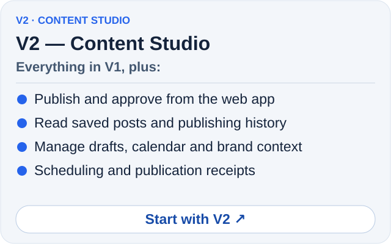](https://github.com/SalamCircle/postforge-ai/blob/v2-pro-portable/docs/CONTENT-STUDIO.md)

[**Complete the V2 foundation: web app, scoped GitHub tokens and editing →**](https://github.com/SalamCircle/postforge-ai/blob/v2-pro-portable/docs/CONTENT-STUDIO.md)

### Already using V1

Preserve your same-account queue and receipts, stop live publishing and other writers, back up your private repository and follow the [V1 to V2 migration requirements](EDITION-SETUP.md#upgrade-v1-to-v2). A complete Core/Pro migration package is required; the historical Alpha workflow does not install Pro.

### Already using V2

Do not repeat LinkedIn setup or create another repository. Follow [V2 to Pro upgrade requirements](EDITION-SETUP.md#upgrade-v2-to-v2-pro). Obtain the reviewed Pro backend package first. Use the reviewed plan/apply migration in [portable installation](PORTABLE-INSTALL.md); it does not require a local server. Provider secrets alone do not install Pro.

### Already using compatible V2 Pro

Skip the installation and proceed to provider configuration only if it is not already complete. Keep existing working keys and settings. Verify your GitHub workspace shows V2 Pro after connecting.

## Step 2 — Open or install the web app

[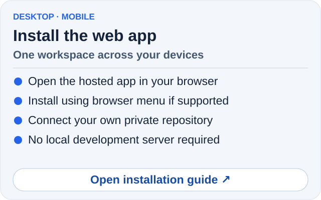](https://salamcircle.github.io/postforge-ai/mobile/)

[**Open PostForge AI on desktop or mobile →**](https://salamcircle.github.io/postforge-ai/mobile/)

Desktop Chrome/Edge: use Install app if offered. Android Chrome: menu → Install app / Add to Home screen. iOS Safari: Share → Add to Home Screen. Installation is optional. No local server is needed. [Visual hosting and installation guide](EDITION-SETUP.md#deploy-or-install-the-web-app).

## Step 3 — Connect your private workspace

[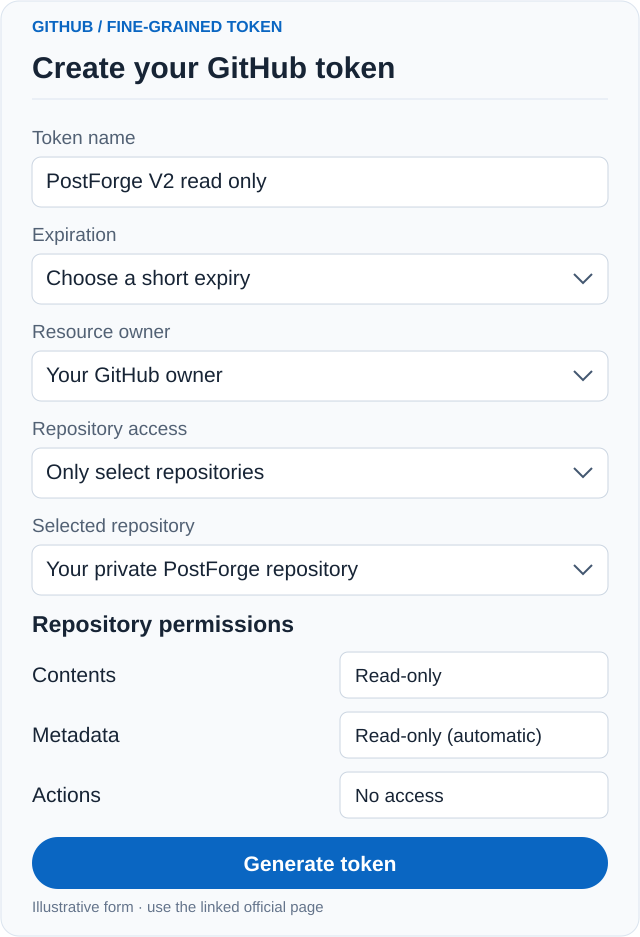](https://github.com/settings/personal-access-tokens/new)

[**Create a fine-grained GitHub read-only token →**](https://github.com/settings/personal-access-tokens/new)

Use the correct resource owner and only your private repository. Set Contents read-only, Metadata read-only (automatic) and leave Actions unset. In the [web app](https://salamcircle.github.io/postforge-ai/mobile/), enter owner/repository and this GitHub token, select Installed main, and Connect. Never enter the LinkedIn token or provider API keys in the app. See [V2 connection instructions](https://github.com/SalamCircle/postforge-ai/blob/v2-pro-portable/docs/CONTENT-STUDIO.md#step-4-connect-your-workspace).

[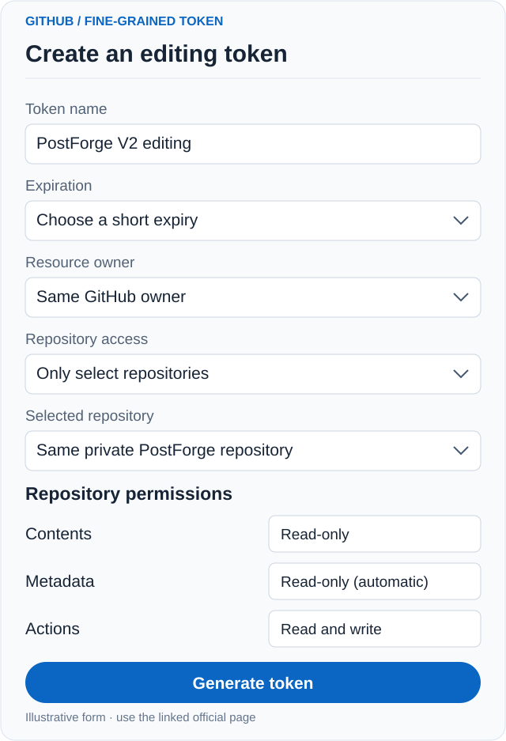](https://github.com/settings/personal-access-tokens/new)

[**Create a separate editing token →**](https://github.com/settings/personal-access-tokens/new)

For editing, use a separate token scoped to the same private repository, Contents read-only and Actions read/write. In the app select More → Workspace settings → Enable editing → enter token → choose duration → Authorize editing. Actions write allows other repository workflows to be dispatched as well. Use short expiry and duration.

## Step 4 — Create your Groq key (AI content generation)

[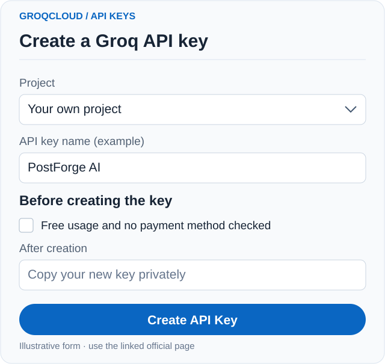](https://console.groq.com/keys)

[**Open Groq API Keys →**](https://console.groq.com/keys)

Sign in or create your own GroqCloud account. Confirm no payment method, paid plan or paid overage before use. Select your project if requested, choose Create API Key, name it PostForge AI if prompted, and copy the generated key privately. [Official quickstart](https://console.groq.com/docs/quickstart) · [Models](https://console.groq.com/docs/models).

## Step 5 — Save the Groq secret in GitHub

[](https://docs.github.com/en/actions/how-tos/write-workflows/choose-what-workflows-do/use-secrets)

[**Open official secret creation instructions →**](https://docs.github.com/en/actions/how-tos/write-workflows/choose-what-workflows-do/use-secrets)

In YOUR private repository: Settings → Secrets and variables → Actions → Secrets → New repository secret. Name: `GROQ_API_KEY`. Secret: paste your own Groq key. Select Add secret.

GitHub help links explain the process. The actual settings URL depends on your private repository. For your own repository use its URL followed by `/settings/secrets/actions/new`. Never place your keys in another person's repository, source code, screenshots or chat.

## Step 6 — Create your Tavily key (web research)

[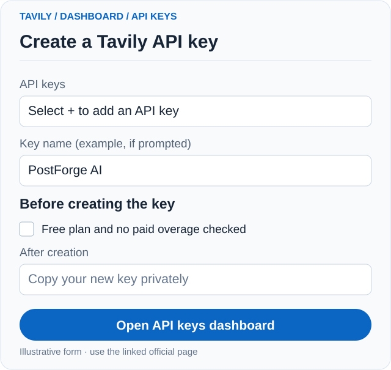](https://app.tavily.com/home)

[**Open Tavily dashboard →**](https://app.tavily.com/home)

Sign in or create your own eligible free account. Verify the current free allowance and no payment method or paid overage. In the API keys section copy the existing key if appropriate, or select + to create a dedicated one. Name it PostForge AI if prompted. [Official key creation guide](https://help.tavily.com/articles/9170796666-how-can-i-create-an-api-key) · [Usage dashboard guide](https://help.tavily.com/articles/7015474742-tavily-usage-dashboard).

## Step 7 — Save the Tavily secret in GitHub

[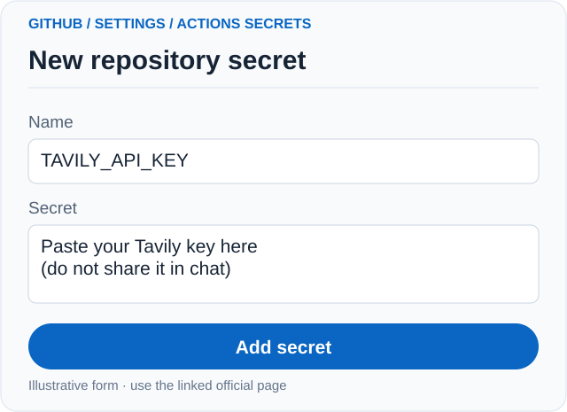](https://docs.github.com/en/actions/how-tos/write-workflows/choose-what-workflows-do/use-secrets)

[**Open official secret creation instructions →**](https://docs.github.com/en/actions/how-tos/write-workflows/choose-what-workflows-do/use-secrets)

Repeat the private repository secret setup with name `TAVILY_API_KEY` and your own Tavily key. Select Add secret. The LinkedIn secret remains unchanged.

## Step 8 — Set the AI model variable

[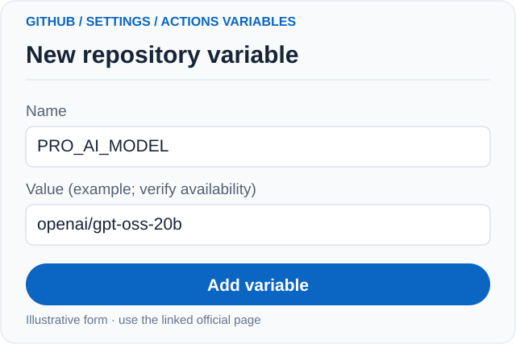](https://docs.github.com/en/actions/how-tos/write-workflows/choose-what-workflows-do/use-variables)

[**Open official variable creation instructions →**](https://docs.github.com/en/actions/how-tos/write-workflows/choose-what-workflows-do/use-variables)

In YOUR private repository, Settings → Secrets and variables → Actions → Variables → New repository variable. Name: `PRO_AI_MODEL`. Value: a supported exact model ID in your [Groq model list](https://console.groq.com/docs/models) that is available to your free account. The current workflow default is `openai/gpt-oss-20b`; it is an example, not a guarantee of eligibility. Keep `PRO_AI_ENABLED` unset while preparing and testing.

## Step 9 — Verify providers safely

[**Open Pro live release acceptance (no publication)**](https://github.com/SalamCircle/postforge-ai/blob/v2-pro-portable/.github/workflows/pro-release-acceptance.yml)

Check your [GitHub billing and included usage](https://github.com/settings/billing), Groq and Tavily allowances first. In your own compatible private repository, Actions → Pro live release acceptance (no publication) → Run workflow → main → confirmation: `VERIFY FREE AI` → style: original → Run workflow. This uses real provider quota and runner minutes but no LinkedIn token or publication; stop if free-only limits cannot be confirmed. Inspect the logs for success. A failure is not permission to enable billing or repeat blindly.

## Step 10 — Enable Pro after passing verification

[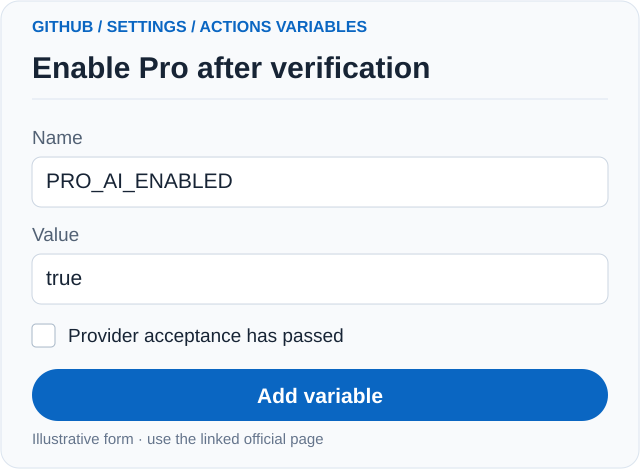](https://docs.github.com/en/actions/how-tos/write-workflows/choose-what-workflows-do/use-variables)

[**Open official variable creation instructions →**](https://docs.github.com/en/actions/how-tos/write-workflows/choose-what-workflows-do/use-variables)

Create the repository variable `PRO_AI_ENABLED` with value `true` after successful verification and confirmed free-only configuration. Existing working Pro installations do not need to reset their settings. Refresh your workspace and verify the Pro edition and Research & AI panel.

## Step 11 — Research, create and publish in the app

[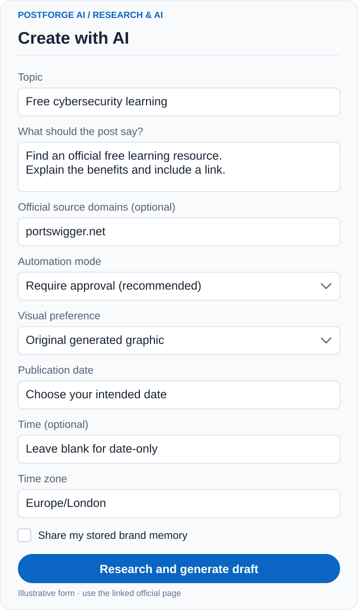](https://salamcircle.github.io/postforge-ai/mobile/)

[**Open PostForge AI and select Research & AI →**](https://salamcircle.github.io/postforge-ai/mobile/)

Enable temporary editing, open Research & AI → Create with AI. Enter your topic, instructions, optional source domains, date/time and timezone. Choose Require approval for the first request and select Original generated graphic if you want a local visual. Press Research and generate draft. Review the saved draft in Approval, check source links and visual, then approve the exact draft and queue it. On compatible installed delivery controls, Publish now can publish an approved queued post with LIVE_PUBLISH enabled and explicit confirmation. Check the receipt and LinkedIn post.

After successful review-mode testing, optional modes are Queue automatically (future timing and TIMED_PUBLISH enabled) or Publish immediately to LinkedIn (one current-UTC-day request, no scheduled time, LIVE_PUBLISH enabled). Every request needs confirmation. Do not enable extra scheduled jobs until free capacity is checked. Source images without authorised reuse require review. Optional advanced AI artwork requires separate free-only configuration below.

All form illustrations are recreated examples, not authenticated screenshots. Provider interface labels may vary by account. Only the linked official pages perform actual key creation or configuration.

---

## Detailed reference and optional features

## Source images

Select Find source-linked image candidates and enter official domains (e.g. aws.amazon.com, skillbuilder.aws). The returned images are candidate links from selected search result pages, not evidence of ownership or permission. Open the source and candidate, check relevance and license. Only supported exact AWS hostnames can be downloaded in the initial attachment implementation: aws.amazon.com, skillbuilder.aws, explore.skillbuilder.aws, a0.awsstatic.com, d1.awsstatic.com and awsstatic.com (source page hosts are the first three). No redirects, arbitrary download hosts or credential forwarding. The user must explicitly confirm permission; images are validated as bounded single-frame JPEG/PNG, normalized to PNG and stored in private studio/assets by SHA-256. Review the exact saved image in the dashboard, then approve the changed draft. The publisher reads only the reviewed local bytes and checks their hash; it never downloads remote images at publication. A generated visual cannot coexist with an attached source image. Unsupported or unavailable images remain links only. Image reuse must be lawful; rights confirmation is the user's responsibility.

## Timing and costs

In review mode, saving content does not queue it. Approve the exact draft and queue it separately. Explicit automatic modes may queue or publish without a subsequent approval; source-image review requirements still apply. Existing timed workflow remains opt-in via TIMED_PUBLISH and uses existing LIVE_PUBLISH authorization. The existing half-hour checks are unchanged by Pro; custom requested times are best effort. These are best effort, not exact minute guarantees. Roughly 48 scheduled checks per day may consume around 1,500 runner minutes in a 30-day month even if no posts are due, plus all other jobs and extra runner time. Verify remaining included minutes and keep paid overages disabled before enabling. Use the daily workflow if budget is tight. Do not enable timed mode without checking account allowance.

## Release gates

Automated tests use synthetic provider and image responses, no real API keys or LinkedIn requests. Live free-provider setup, real source/rights review, real mobile image attachment, delivery verification and installation/rollback are separate acceptance gates. Full multi-platform integrations and freeform persistent chat remain future extensions. Do not merge into the live publisher or market this as stable until these checks pass.

The Pro research runner has its own concurrency group; its draft-only commit uses the reviewed snapshot and a non-force push. If publishing or another writer advances main during research, the draft commit is rejected rather than overwriting content. Refresh and inspect workflow history before retrying. Disabled Pro requests fail explicitly instead of reporting a skipped job as a successful draft.


## Optional per-request automation
- **Require approval** is the default on connection. Generated drafts remain unapproved.
- **Queue automatically** requires an explicit confirmation and a future time for every item, with TIMED_PUBLISH enabled. The exact generated draft receives a recorded automation authorization and is queued using the existing publisher. Delivery is best effort, not a guaranteed minute.
- **Publish immediately** requires one request for the current UTC day with no scheduled time, LIVE_PUBLISH enabled, and explicit confirmation. It uses the existing publisher and verifies the receipt. A failed immediate attempt leaves a draft, not an automatically publishable queue entry. Claims are never retried automatically.
- Request “add visual” or select the original graphic option to attach a locally rendered PNG. This is a text-based original poster, not generative photography. Source-image discovery remains a separate reviewed route requiring reuse rights. Automatic modes refuse real source-image requests.
- Delete one or up to 30 unqueued, unpublished drafts from the current workspace. Git history and shared assets are retained. Queued posts must be removed or rescheduled first. No published posts or receipts are deleted.
- No new scheduled checks or paid image providers are introduced. Provider and GitHub usage limits still apply. Automation jobs share the publisher concurrency group; GitHub scheduling and competing jobs can delay or cancel pending runs. Inspect the outcome before retrying.

## Bounded AI recovery
One recovery attempt is shared across each request or three-item plan. If evidence is missing, search again using the topic alone with unchanged domain restrictions. If the model returns insufficient evidence, refresh research and regenerate once; other invalid model output can be regenerated once using the original evidence. No invented citations, automatic publication retries, or automatic retries of failed provider calls. This can use at most one extra search and one extra generation per plan; provider free limits and the existing job timeout still apply. Insufficient evidence after recovery remains a failure. The user-selected review/queue/publish mode and authorization checks are unchanged.

## Private request recovery
Accepted Pro requests are recorded in `studio/requests/<GitHub run ID>.json` before contacting providers. The record includes the submitted instructions and original timing, selected mode, sanitized outcome and exact resulting draft IDs; no provider keys or raw responses are stored by the journal. Only the 25 newest records are shown by the mobile app. Records and their Git history persist in the private deployment. Do not include secrets in prompts. Failed requests can be restored into the form or plan in review-required mode, never automatically resubmitted. Interrupted or uncertain publication records require reconciliation. A request rejected before journal creation or a concurrent push failure may not have a final record; inspect its original run. Same-run replays cannot regenerate a recorded request. If time expires during research, all generated drafts are saved unapproved; expired timings are cleared and the original times retained in the journal. Original graphics are rendered and checked before committing drafts. All existing publication claims and schedules are unchanged. Journaling adds repository commits, and renderer installation adds some runner time; monitor free usage. No new scheduled jobs or paid providers.

## Smart Auto Visual
Choose Automatic detection, Smart Auto Visual, Original generated graphic, Reusable source image only, or Text only. Automatic queue/publish requests for an actual image now use Smart Auto Visual instead of failing. A matching reusable source image must already be authorised by the private workspace owner and stored as immutable, staged PNG bytes. An official hostname, search result or AI assertion alone is never a licence. This version does not automatically discover or independently verify third-party licences. Without a valid grant, Smart Auto Visual uses the existing local original graphic renderer. Source-only saves unapproved drafts and never auto-queues or publishes if any required image is missing. Text-only overrides image requests in the instructions. Original graphics are not third-party official artwork.

### Optional owner-managed reusable image library
After staging an image through the reviewed attachment flow, the owner may create `studio/reusable-images.json` privately. Only register assets for which you have confirmed indefinite permission for repeated public posting (including processing/resizing), and for which a plain-text credit and the cited source URL meet all licence conditions. Do not register restricted, expiring, or unclear licences. The image object must be copied exactly from the staged draft's `approved_image` object (sha256, url, source, rights). Example structure (placeholders only, not a real licence):

```json
[
  {
    "image": {"sha256": "<existing staged SHA-256>", "url": "<existing supported image URL>", "source": "<exact cited source URL>", "rights": "USER_CONFIRMED_PERMISSION"},
    "permission": "OWNER_CONFIRMED_REUSABLE_WITHOUT_EXPIRY",
    "attribution": "<required creator and licence credit>"
  }
]
```
Up to 50 entries; exact source matching and immutable image hash validation. The current source-image host allowlist remains unchanged. No new download or licensing API is used. Remove any invalid grants and cancel affected queued posts before publication. This is owner-managed configuration, not an in-app rights registry editor. No new paid services or recurring workflows. A valid original visual is rendered before saving and the existing publisher attaches it to the LinkedIn post.

## Optional Advanced AI Image Engine (FLUX.1 Schnell)
The normal local graphics and Smart Auto Visual remain unchanged and require no new API. Advanced image styles (photo concept, editorial illustration, poster artwork) use the optional Cloudflare Workers AI adapter. It is disabled by default. This is conceptual artwork, not an official screenshot or photo of an actual event. The caption explicitly discloses AI generation. Posters are artwork without guaranteed readable typography. The exact normalized PNG is stored privately by SHA-256 and is included in the draft approval and queue payload. It is previewable in the mobile review panel. No additional provider calls occur during publishing.

### Strict zero-out-of-pocket configuration
Cloudflare documents a Workers Free allowance of 10,000 neurons/day and rejects usage beyond that allowance on the Free plan. See https://developers.cloudflare.com/workers-ai/platform/pricing/ and https://developers.cloudflare.com/workers-ai/models/flux-1-schnell/ . Use ONLY a dedicated Workers Free account with no payment method, no paid plan, no prepaid AI Gateway credits and no other billable resources. Never enable billing to make generation work. The app cannot independently inspect or guarantee your Cloudflare billing plan; do not activate the adapter if you cannot verify these conditions. Provider policies can change. To disable instantly, set PRO_IMAGE_ENABLED=false and revoke the token.

1. Create a free Cloudflare account (no card); verify the Workers Free plan in its dashboard. If asked for payment, stop and use local graphics.
2. Follow https://developers.cloudflare.com/workers-ai/get-started/rest-api/ to create an account-scoped Workers AI read API token. Do not give it billing/write permissions. Copy the account ID.
3. In the PRIVATE repository Settings → Secrets and variables → Actions, add a secret named CLOUDFLARE_IMAGE_TOKEN and variables CLOUDFLARE_ACCOUNT_ID, PRO_IMAGE_FREE_ONLY with value DEDICATED_WORKERS_FREE_NO_PAYMENT_METHOD, and finally PRO_IMAGE_ENABLED=true. Do not paste the token in prompts or the mobile form. Leave PRO_IMAGE_ENABLED unset if you want no external image calls.
4. In Research & AI select an AI image style and Review required for the first live test. Inspect the exact saved image before publishing.

Only one optional image request per plan; additional images use local graphics. Fixed model, four steps, no retries or paid fallback, bounded response size, timeout, PNG normalization and size validation. Disabled/unconfigured provider, quota/HTTP errors or unusable responses retain a local graphic and record the reason. No new packages or recurring workflows. The provider receives topic/headline/style; avoid sensitive topics, confidential data or secrets in either field. Actual generated content quality and provider availability are not guaranteed by automated fixture tests. Review required is recommended for first live test and sensitive topics. Existing GitHub usage limits remain applicable.

## Release acceptance and mobile defaults
Use the manual Pro live release acceptance (no publication) workflow on private main. Enter VERIFY FREE AI only after checking included Actions minutes and free-only provider configuration. Choose original to exercise live Tavily/Groq, local graphics, review-only draft saving, automatic queueing and the publisher dry run. All writes happen in a temporary directory that is removed on exit. The workflow has read-only repository permissions and no LinkedIn token. Choose ai-illustration only after the dedicated Workers Free adapter is configured; a local fallback is intentionally not counted as a passed live artwork test. Neither choice proves real LinkedIn delivery. Verify live queue/publish on a separately approved real post and inspect its receipt. Do not release as stable based on fixtures alone.
The mobile calendar offers week navigation and date filtering within its selected UTC date window. Date counts reflect all loaded posts, independent of status/search filters. Save defaults in Research & AI stores only the selected automation and visual choices in browser local storage; it does not store credentials, topic or post text. Defaults are device-wide, not a publishing authorization, and each request still needs explicit confirmation. Reset defaults restores review required and automatic visual detection. Restoring a failed request continues to force review-only mode.

### Research-source reliability

Source restrictions are normalized case-insensitively and deduplicated before the five-unique-hostname limit is applied. The mobile form checks the same limit before submitting; restoration removes repeated hostnames. URLs, paths and more than five distinct hostnames are rejected, never silently dropped or expanded. Release acceptance includes repeated hostnames to exercise this regression. Advanced artwork still requires a separately verified, dedicated Workers Free account with no payment method; unconfigured or unavailable inference retains the local graphic. No automatic paid fallback or additional request is introduced.

### Fresh workspace preflight

The mobile client checks the private branch head before opening confirmation and again after confirmation, before any dispatch. If the snapshot changed, the app refreshes read-only and requires a new reviewed action; it never automatically resubmits. If the head cannot be verified, no dispatch occurs. Form input remains available; review current drafts, history and timing before confirming again. Backend snapshot and publication-claim checks are unchanged, including the small race between browser check and workflow startup. Browser regression tests exercise both stale intervals, unavailable ref checks and one successful dispatch after refresh.
