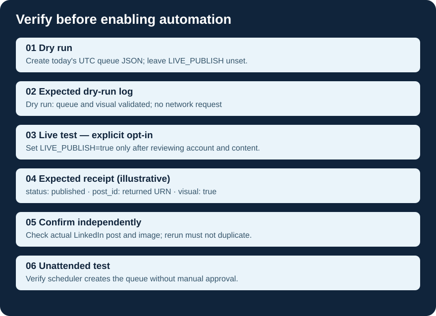
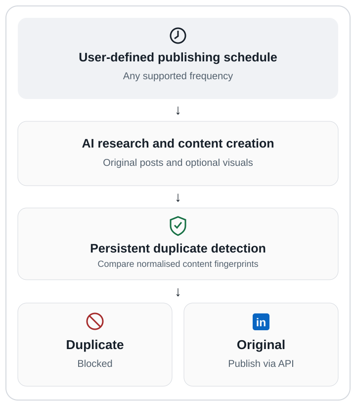

# Verification guide



These are expected outcomes, not screenshots of completed community tests.

## Safe test
Open Actions in your private deployment, select Tests, and inspect every job. Leave LIVE_PUBLISH unset. Copy examples/post.json to queue/YYYY-MM-DD-HHMMSS.json (today in UTC), replacing the date and text. Select PostForge Publisher → Run workflow → main if a push did not trigger it. A successful dry run prints `Dry run: queue and visual validated; no network request`. This does not verify the token or image upload.

## Live test
Confirm your token belongs to your intended member account in LinkedIn's OAuth tools. Review the queue content, billing and permissions. Set Actions repository variable LIVE_PUBLISH to true. Dispatch PostForge Publisher on main. Unlike the original personal workflow, there is no mode dropdown or post text field.

Inspect state/<content-fingerprint>.json. Expected example (not actual evidence):
```json
{"status":"published","post_id":"urn:li:share:EXAMPLE","visual":true}
```
Open [LinkedIn](https://www.linkedin.com/feed/) and confirm the text and image. A claimed receipt alone is not success. If claimed or uncertain, stop and investigate; do not delete the claim or retry blindly.

## Automation verification
Schedule the external LLM to create one dated queue file on a future day. Confirm the write occurred without interactive approval, the workflow ran, and the receipt and actual post match. Rerun only after confirmed publication to verify the existing receipt prevents a second post. Disable LIVE_PUBLISH when finished if not ready for unattended operation.

## Release evidence
Record CI run URL, dependency scan results, independent live test receipt (redacted), image verification, unattended test and security review. Do not label the release verified until all checks pass.

## Multiple posts and duplicate protection



[Follow the visual multi-post scheduling and verification guide](MULTI-POST.md). Choose your own publishing frequency, create unique queue files and preserve content-based receipts. The diagram illustrates intended behaviour; live verification is separate.
