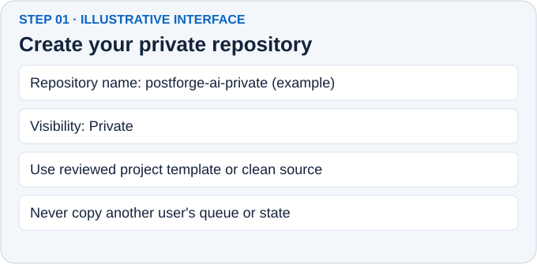
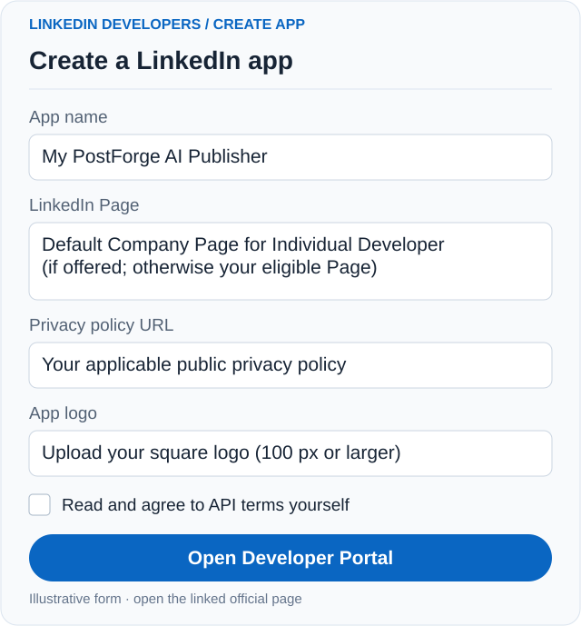
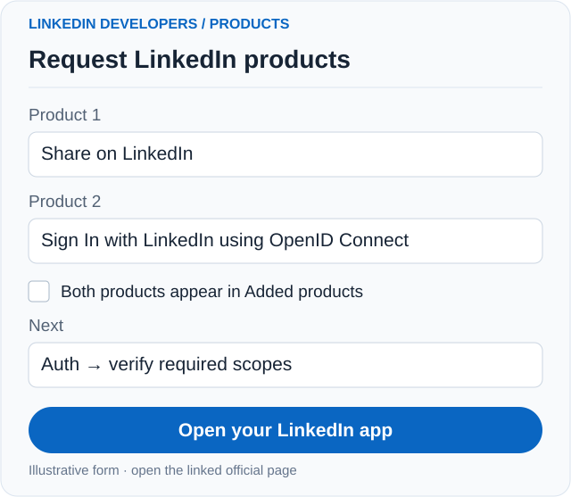
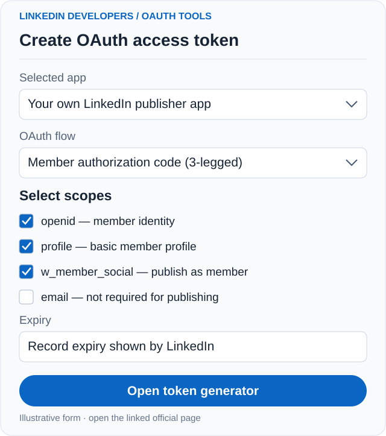
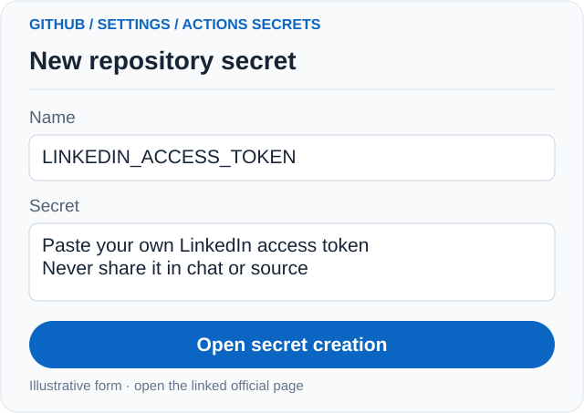
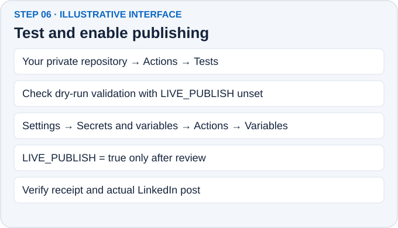
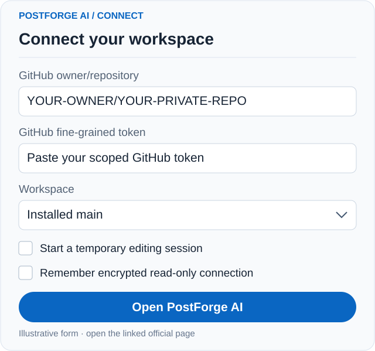
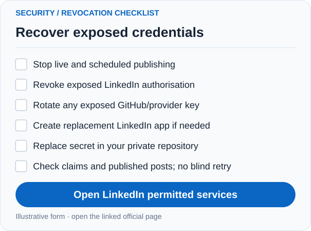
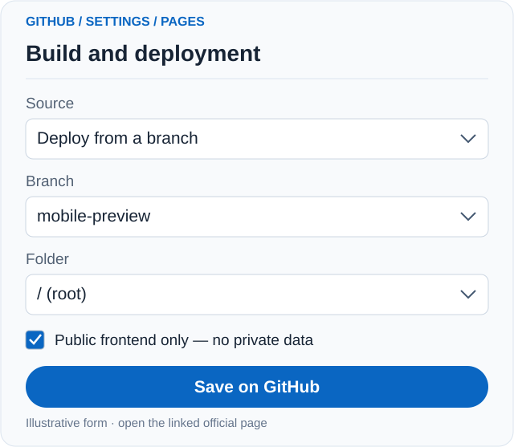

# PostForge AI — complete visual setup

For desktop and mobile. No local server required. Illustrations are recreated examples, not live screenshots. Existing users do not need to repeat setup.

## Step 01 — Create your private repository

[Open relevant settings or official guide](https://github.com/new)

Create a private repository using the reviewed community template if available. Otherwise follow GitHub's repository import instructions using clean community source. Do not fork into a public repository. Confirm the publisher workflow and README identity are present. [Template instructions](https://docs.github.com/en/repositories/creating-and-managing-repositories/creating-a-repository-from-a-template).

---

## Step 02 — Create a LinkedIn developer app

[Open relevant settings or official guide](https://www.linkedin.com/developers/apps)

Open My Apps → Create app. Use your own descriptive name, not someone else's company. If the individual developer default page is unavailable, use an eligible Page you are authorised to manage. Do not use an unrelated company. Provide your own applicable privacy policy; review the API terms before agreeing.

---

## Step 03 — Enable LinkedIn products

[Open relevant settings or official guide](https://www.linkedin.com/developers/apps)

Share on LinkedIn enables member publishing; OpenID Connect provides identity. Wait for access. Advertising and Community Management are not required for basic publishing. Open Auth and verify granted scopes.

---

## Step 04 — Generate your member access token

[Open relevant settings or official guide](https://www.linkedin.com/developers/tools/oauth)

Use the OAuth token generator. Sign in to the intended LinkedIn member account and review consent. Note expiry shown by LinkedIn. Email scope only supplies the primary email address; it does not read mail or errors. Never share the token or client secret with an AI agent.

---

## Step 05 — Configure GitHub secrets

[Open official Actions secrets instructions](https://docs.github.com/en/actions/how-tos/write-workflows/choose-what-workflows-do/use-secrets)

For your own deployment, open your private repository and append `/settings/secrets/actions/new` to its URL. The official link above is a help page, not your private settings; never enter your credentials in another person's repository. [Official GitHub guide](https://docs.github.com/en/actions/how-tos/write-workflows/choose-what-workflows-do/use-secrets).

Save the secret directly in GitHub. Do not put it in a file, repository variable, screenshot or chat. Leave LIVE_PUBLISH unset for testing. Check [billing](https://github.com/settings/billing) before running jobs.

---

## Step 06 — Test and enable publishing

[Open community Actions examples](https://github.com/SalamCircle/postforge-ai/actions) · [Actual repository variables](https://docs.github.com/en/actions/how-tos/write-workflows/choose-what-workflows-do/use-variables)

For your own deployment use your own repository's `/actions` and `/settings/variables/actions` pages.

Follow [verification](VERIFY.md). Community Actions link is an example, not your private workflow. Dry-run does not verify authentication. Review the exact content before enabling live publishing. Never retry an unresolved claim.

---

## Step 07 — Connect desktop or mobile

[Open relevant settings or official guide](https://salamcircle.github.io/postforge-ai/mobile/)

Create a [fine-grained token](https://github.com/settings/personal-access-tokens/new) restricted to your private repository. Use minimum permissions described in [mobile guide](MOBILE.md). Do not enter the LinkedIn token. Optionally save encrypted connection with a separate passphrase.

---

## Step 08 — Recover from exposed credentials

[Open relevant settings or official guide](https://www.linkedin.com/psettings/permitted-services)

Revoke access promptly; deleting an app alone is not a substitute for checking token revocation. In [Developer Portal](https://www.linkedin.com/developers/apps), inspect Settings for deletion if available; otherwise contact LinkedIn support. Repeat steps 2–5 for a replacement app. Rotate any exposed client secret or GitHub token separately. Inspect logs, repository history and LinkedIn activity. Do not delete claims or receipts. Resume only after verification.

## Install the hosted web app

1. Open the existing [hosted web app](https://salamcircle.github.io/postforge-ai/mobile/) in Chrome or Edge (desktop), Chrome (Android) or Safari (iOS). No server or Python required.
2. On desktop choose the browser's Install app option if available; on Android use menu → Add to Home screen / Install app; on iOS use Share → Add to Home Screen. If installation is unavailable, bookmark the URL and use the browser.
3. Connect your own compatible private main using Step 07. If self-hosting, use only a clean public frontend-only repository with the mobile-preview branch, Settings → Pages → Deploy from a branch → mobile-preview → / (root) → Save. Never expose the private publishing repository.

## Optional V2 Pro

[Open the dedicated Pro setup guide](V2-PRO.md). Use your own free-tier providers only after checking quotas and billing. [AI prompts](PROMPTS.md) · [Verification](VERIFY.md).
